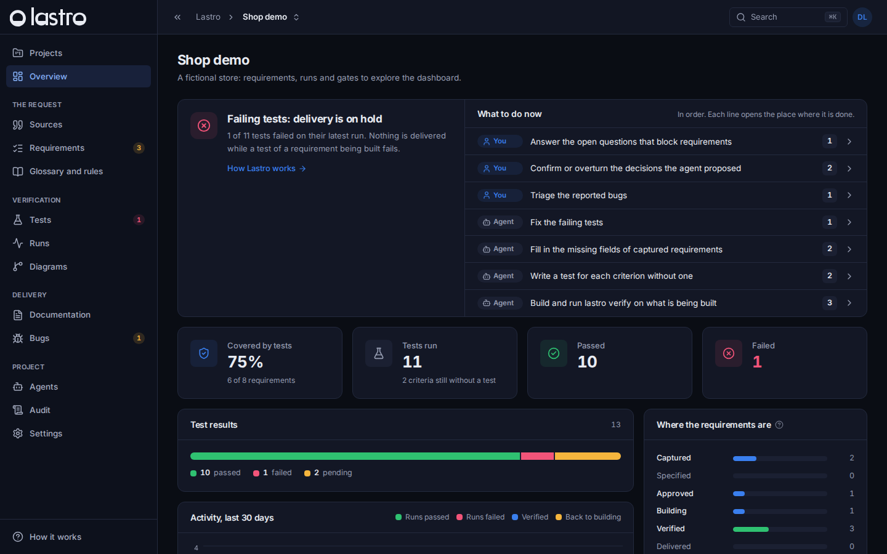
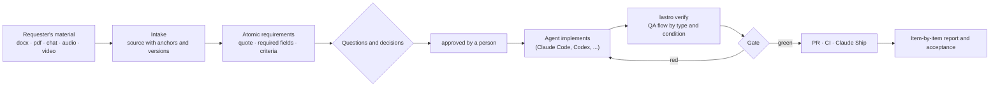
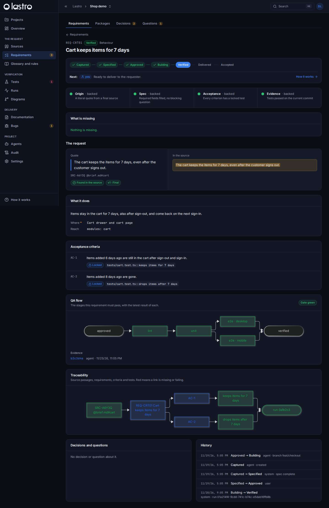
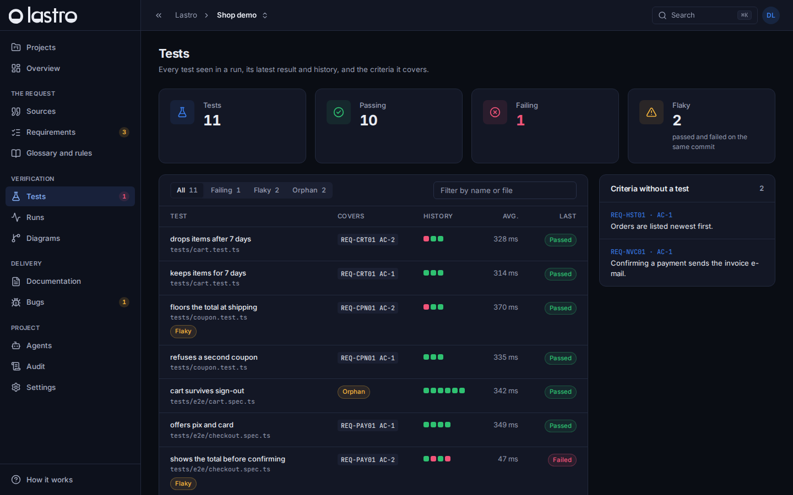
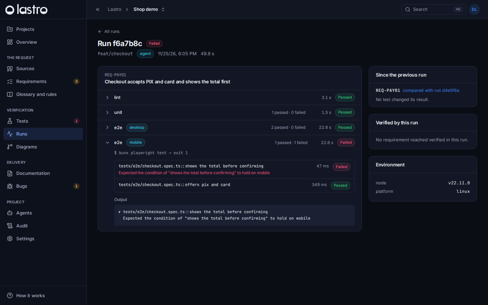
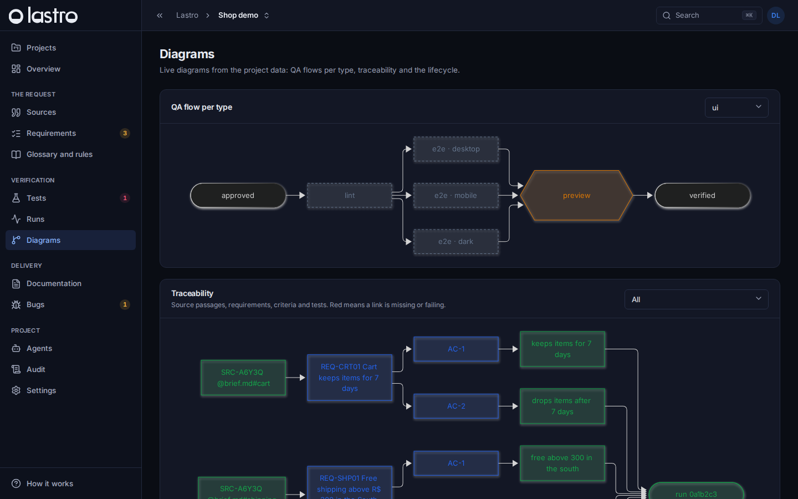
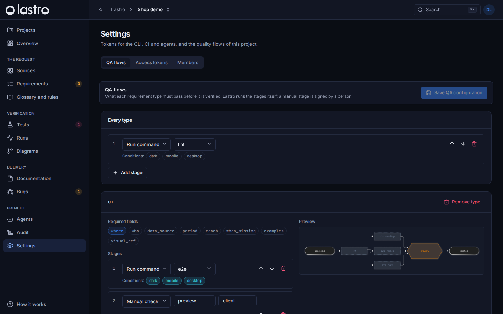
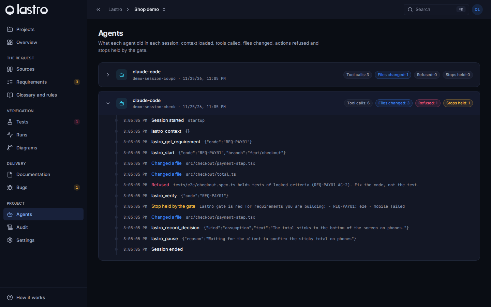
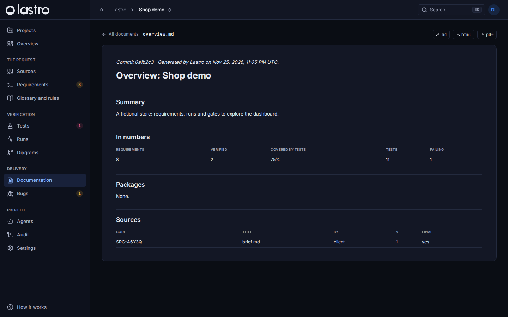

<p>
  <picture>
    <source media="(prefers-color-scheme: dark)" srcset="docs/brand/readme-dark.svg">
    
  </picture>
</p>

**Requirements, evidence and quality gates for AI-driven development. Nothing is done without lastro.**

**English** · [Português](README.pt-BR.md)

*lastro (pt-BR): the backing that gives something its value.*



With AI agents, writing code is no longer the bottleneck. The bottleneck is the path between what was asked for and what was delivered:

- the request arrives in pieces (message, audio, video, document, screenshot);
- the agent fills in the gaps on its own and doesn't say so;
- the tests confirm the agent's interpretation, not the requester's;
- what was agreed gets lost between sessions and compactions;
- the requester finds the difference in production.

Lastro is an open source layer between the requester, the agent that writes the code, and whoever accepts the delivery. A requirement is only done when it has three things:

1. **Origin.** The literal quote from the request, with its anchor: section, paragraph, page, message, minute of the video. Lastro checks the quote against the source.
2. **Acceptance.** Criteria with the requester's examples and numbers, locked once a person approves them, so the agent can't edit them or their tests.
3. **Evidence.** A run that Lastro executed itself, under every condition the requirement's type demands, bound to the files it touches. When those files change, the evidence goes stale.

## How it works



- **Postgres is the source of truth; git gets the export.** One self-hosted server holds every project. `lastro export` writes a deterministic `.lastro/` snapshot that is reviewed in the same pull request as the code.
- **No LLM inside.** The agent you already use does the thinking. Lastro stores, enforces and checks. No API key, no token cost, no client data sent anywhere.
- **Human actions stay human.** Approving, accepting, unlocking criteria, signing manual stages, importing a snapshot and changing the QA configuration are refused for agent tokens in the core, not only in the hooks.
- **Agnostic.** Claude Code first, with a CLI and an MCP server for any agent, on any stack whose tests write JUnit and whose linters write SARIF.

## The dashboard

| | |
|---|---|
|  |  |
| **Requirements:** the quote next to the source passage, fields, locked criteria, the live QA flow and what still holds it back | **Tests:** every test seen in a run, its history, flaky and orphan tests, criteria without a test |
|  |  |
| **Runs:** stages per condition, test results, SARIF findings, output and the comparison with the previous run | **Diagrams:** QA flows per type, traceability from source to test, module map and lifecycle, generated from the data |
|  |  |
| **Settings:** visual editor of QA flows, conditions, commands and gate; access tokens; members | **Agents:** what each agent did in each session, refused actions and stops held by the gate |

Also: a How it works page and plain-language help on every term, sources with versions and anchored passages, packages, decisions and questions, bugs with triage and billing, glossary, invariants and layout contract, an append-only audit log, light and dark themes, English and Portuguese.

**Documentation** is generated from the data in Markdown, HTML and PDF, each document stating the commit and date it comes from: overview, requirements by package, business rules and invariants, architecture, decisions, test plan, test cases, quality report, delivery history, diagrams and a delivery report for the requester. `lastro report <PKG>` writes the item-by-item report of a package in the requester's own order and numbering.



## Three levels of assurance

| Level | How |
|---|---|
| Guidance | The project context (active requirements, criteria, glossary, invariants, decisions, open questions) goes back to the agent at the start of every session and after every compaction |
| Control | Claude Code hooks: the agent can't end its turn while it can fix a red gate, can't edit a locked test or the `.lastro/` export, can't run human commands |
| External blocking | `lastro gate` in a `pre-push` hook and as a required check in CI (GitHub Action included) |

## Quick start

**1. Server** (dashboard, API and MCP endpoint), on one machine with Docker:

```bash
git clone https://github.com/srnakyo/lastro.git && cd lastro
cp .env.example .env      # set LASTRO_URL, BETTER_AUTH_SECRET and POSTGRES_PASSWORD
docker compose -f docker/compose.prod.yml --env-file .env up -d
```

Open `LASTRO_URL`, create your account and workspace, then a project. Create tokens in **Settings › Access tokens**: a person's token for the CLI and CI, an agent token for MCP.

**2. CLI** in your repository:

```bash
npm install -g lastro
lastro login --url https://lastro.example.com --token <token>
lastro init my-app            # or: lastro link my-app
lastro intake "brief v4.docx"
lastro pending
lastro verify REQ-K7Q2M
lastro gate
lastro docs build --format md,pdf
lastro install-hooks          # git pre-push runs lastro gate
```

**3. Claude Code:**

```
/plugin marketplace add srnakyo/lastro
/plugin install lastro@lastro
```

Log the CLI in with an **agent** token on the machine where Claude Code runs. The plugin adds the hooks, the `lastro` MCP server and the skills `/lastro:intake`, `/lastro:spec`, `/lastro:build`, `/lastro:report` and `/lastro:triage`. Other agents connect to `lastro mcp` (stdio) or to `/api/mcp` over HTTP with a Bearer token.

**4. CI and review:** the [GitHub Action](packages/adapters/github-action) runs `lastro verify` and `lastro gate`, with a job summary. The [Claude Ship templates](packages/adapters/claude-ship) bring a `REVIEW.md` for Claude Code Review and a Claude Approvals policy with the `lastro_scope` classifier.

## Development

Requirements: [Bun](https://bun.sh) 1.3, Node 22 and Postgres 16 (or `docker compose -f docker/compose.dev.yml up -d`).

```bash
bun install
cp .env.example .env                      # point LASTRO_DATABASE_URL and LASTRO_TEST_DATABASE_URL at your Postgres
(cd packages/database && bunx prisma migrate deploy && bunx prisma generate)
(cd apps/web && bun run dev)              # http://localhost:4317
bun scripts/seed-dev.ts                   # dev@lastro.local / lastro-dev-password, with the shop-demo project
bun run test                              # unit and integration tests against lastro_test
bunx playwright test                      # the real screens, desktop and phone
bunx eslint . && bun audit
```

| Folder | What it is |
|---|---|
| `apps/web` | Dashboard, REST API (`/api/v1`) and MCP endpoint (`/api/mcp`): TanStack Start |
| `packages/core` | Domain services, one folder per domain; every operation is scoped by project |
| `packages/database` | Prisma schema and migrations, append-only audit enforced by a trigger |
| `packages/shared` | zod contracts used by the API, the CLI, MCP and the export format |
| `packages/cli` | The `lastro` command; talks to the API, never to the database |
| `packages/runner` | Runs project commands per condition, reads JUnit and SARIF |
| `packages/intake` | Source extractors: Markdown, DOCX with images in order, PDF, chat exports, audio and video |
| `packages/storage` | Local or S3-compatible storage for sources, images and documents |
| `packages/docs` | Document and Mermaid diagram generators, HTML and PDF rendering |
| `packages/adapters` | Claude Code plugin, git hook, GitHub Action, Claude Ship templates |

The [PRD](docs/prd/README.md) describes the product: the problem, the data model, the lifecycle, the QA flows and the architecture. The [ROADMAP](ROADMAP.md) tracks the build. [`.lastro/`](.lastro) is Lastro itself, described in its own format.

## Contributing

Issues and pull requests are welcome: tell us how the gap between request and delivery shows up in your workflow, or propose an adapter for your agent or stack. Read [CLAUDE.md](CLAUDE.md) for the rules the code follows.

## License

[MIT](LICENSE)
