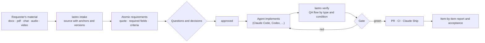

# Lastro

**Requirements, evidence and quality gates for AI-driven development. Nothing is done without lastro.**

**English** · [Português](README.pt-BR.md)

> **Status:** rebuild in progress. The [PRD](docs/prd/README.md) describes the product, and the [ROADMAP](ROADMAP.md) tracks the build, phase by phase.

---

*lastro (pt-BR): the backing that gives something its value.*

With AI agents, writing code is no longer the bottleneck. The bottleneck is now the path between what was asked for and what was delivered:

- the request arrives in pieces (message, audio, video, document, screenshot);
- the agent fills in the gaps on its own and doesn't say so;
- the tests confirm the agent's interpretation, not the requester's;
- what was agreed gets lost between sessions;
- the requester finds the difference in production.

Lastro is an open source layer between the requester, the agent that writes the code, and whoever accepts the delivery. An item is only done when it has three things:

1. **Origin.** The literal quote from the request, with its anchor: page, message, minute of the video.
2. **Acceptance.** Criteria written with the requester's examples and numbers, locked so the agent can't edit them.
3. **Evidence.** The result of a run performed by Lastro itself, on the current commit, under real usage conditions.

## How it works



- **Spec on the server, review in the PR.** The Lastro server's Postgres is the source of truth, and `lastro export` writes a deterministic snapshot to `.lastro/`, reviewed in the same PR as the code.
- **No LLM inside.** The agent you already use does the thinking. Lastro stores, enforces and checks.
- **Visual dashboard.** Tests, runs and results, live diagrams of the QA flows and of traceability, and documentation generated from the data.
- **Self-hosted, many projects.** One server with Docker, on a single VPS, holds every project of the workspace, with sign-in and a project switcher. The dashboard, the MCP and the CLI write through the same API.
- **Agnostic.** Claude Code first, with a CLI and MCP for any agent, on any stack that produces JUnit or SARIF.

## Three levels of assurance

| Level | How |
|---|---|
| Guidance | Project context injected into every session and after every compaction |
| Control | Agent hooks: it can't stop with the gate red, can't edit a locked test, can't approve its own spec |
| External blocking | `pre-push`, a required CI check and branch protection |

## What using it will look like

```bash
# server: dashboard, API and MCP
docker compose -f docker/compose.prod.yml up -d

# CLI
npm install -g lastro      # not published yet
lastro login https://lastro.example.com
lastro link my-app         # links the repository to a project on the server
lastro import              # loads the .lastro/ already in the repository
lastro setup claude        # MCP, hooks and CLAUDE.md
lastro intake "Fixes v.4.docx"
lastro pending
lastro approve PKG-2R8XW
lastro verify
lastro gate
lastro export              # writes the snapshot to .lastro/ for the PR
lastro report PKG-2R8XW --format pdf
lastro docs build --format pdf
```

## Documentation

- [PRD](docs/prd/README.md): the problem, the data model, the lifecycle, the QA flows, the integrations and the architecture.
- [ROADMAP](ROADMAP.md): the build phases and the status of each one.
- [`.lastro/`](.lastro): Lastro itself, described in the export format.

## Contributing

The rebuild is in progress (see the [ROADMAP](ROADMAP.md)). Open an issue to discuss the PRD, tell us how the problem shows up in your workflow, or propose an adapter for your agent or stack.

## License

[MIT](LICENSE)
