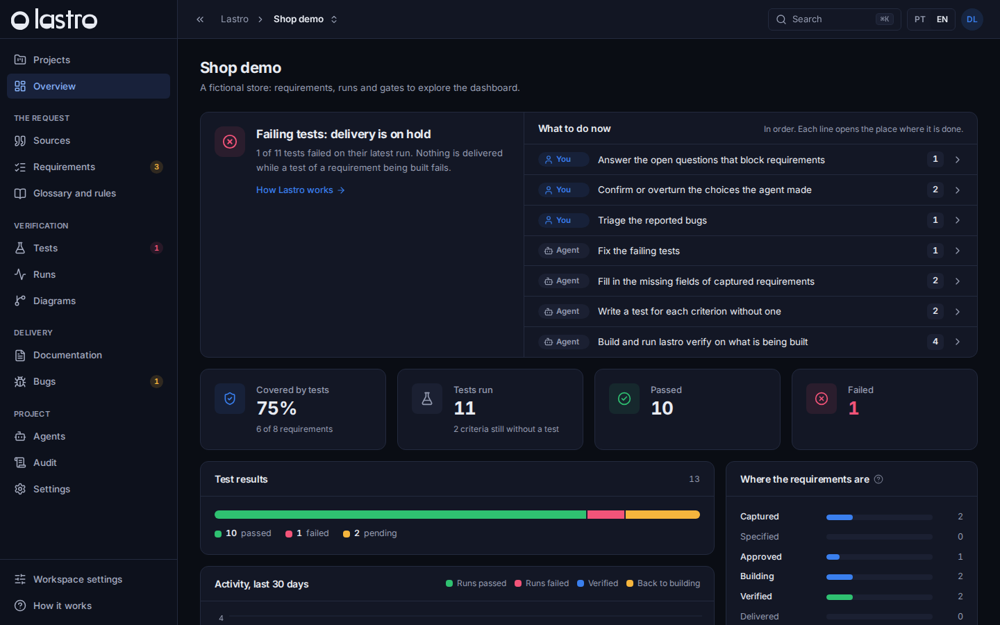
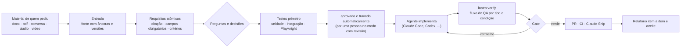
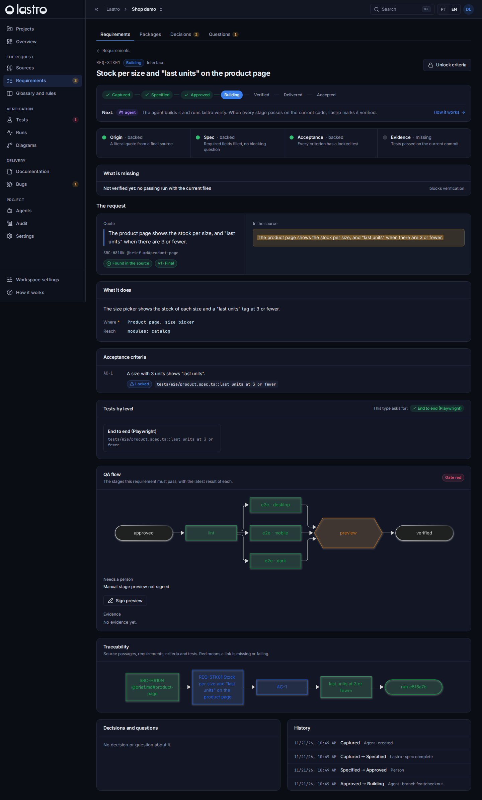
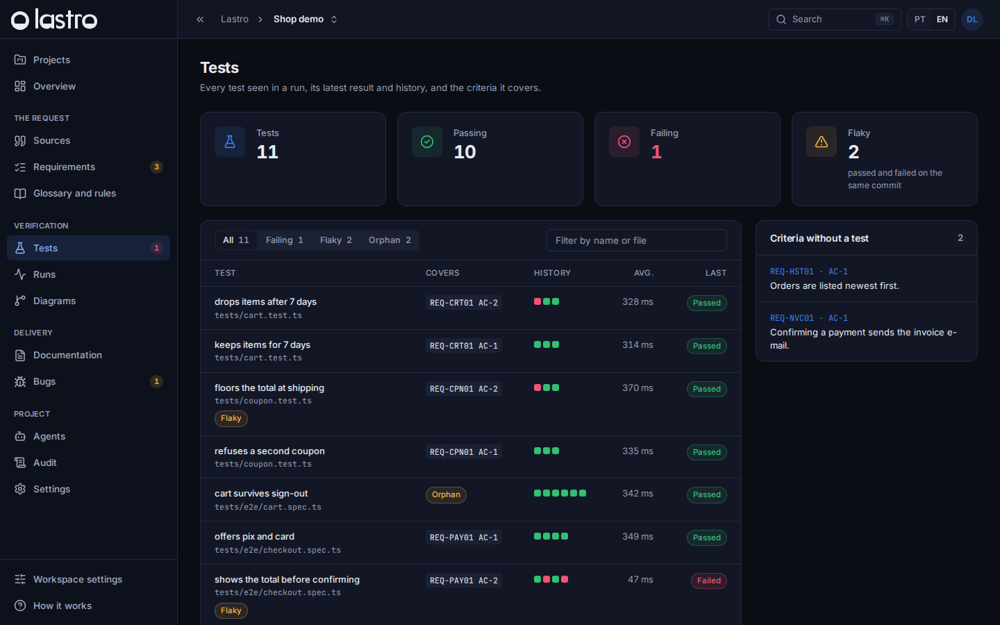
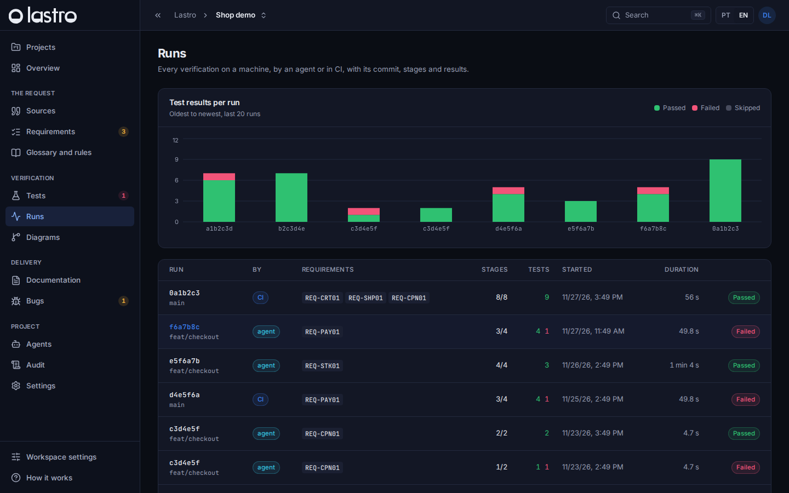
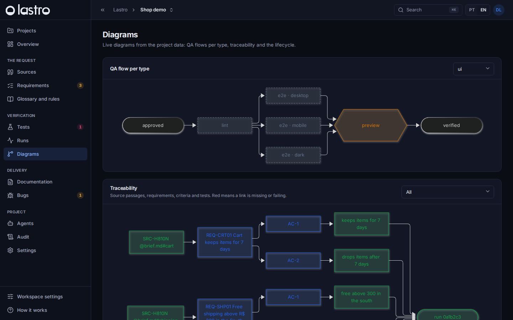
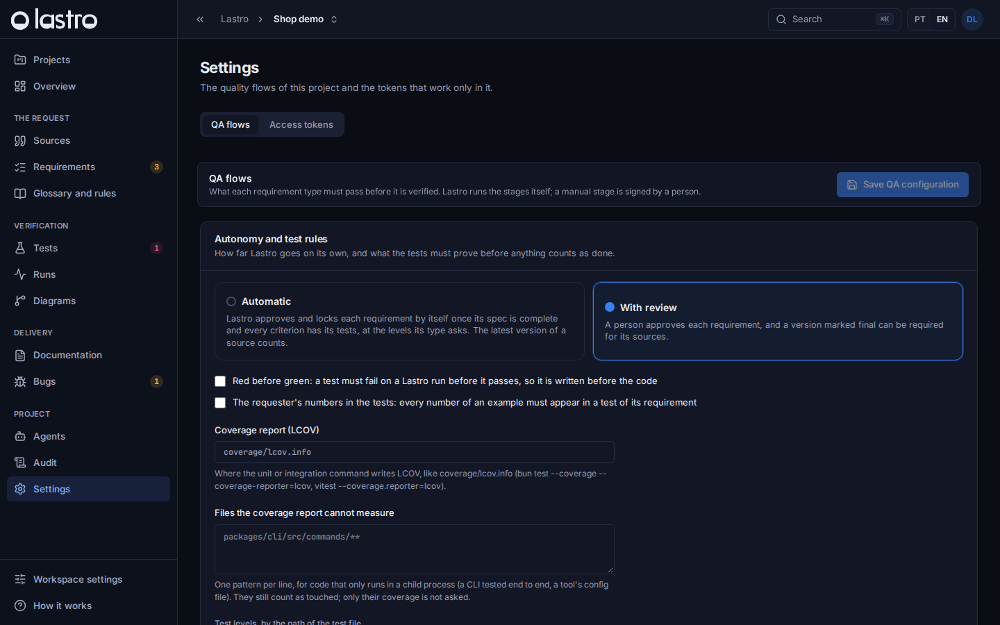
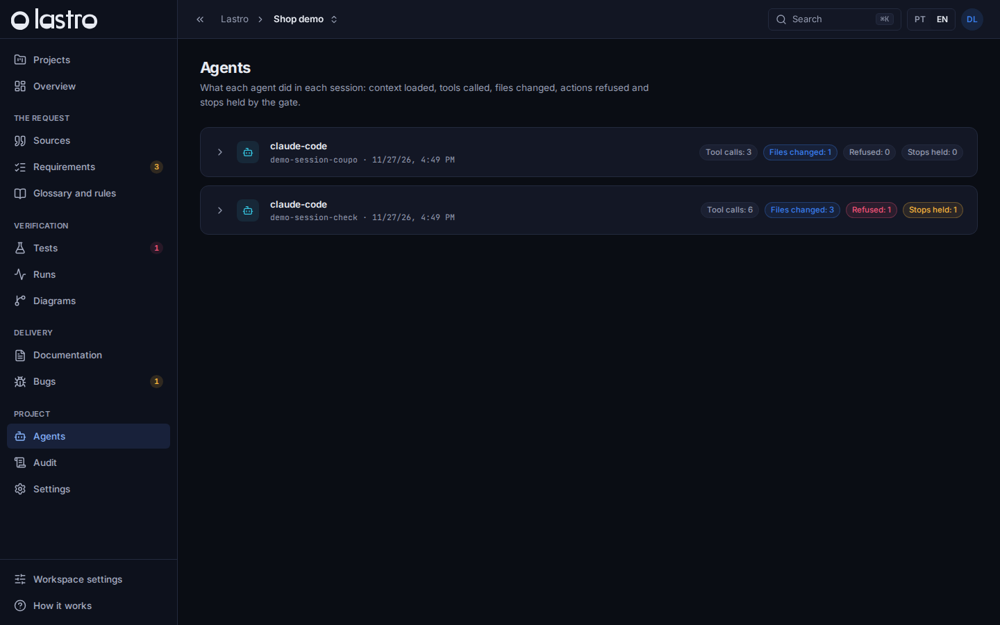
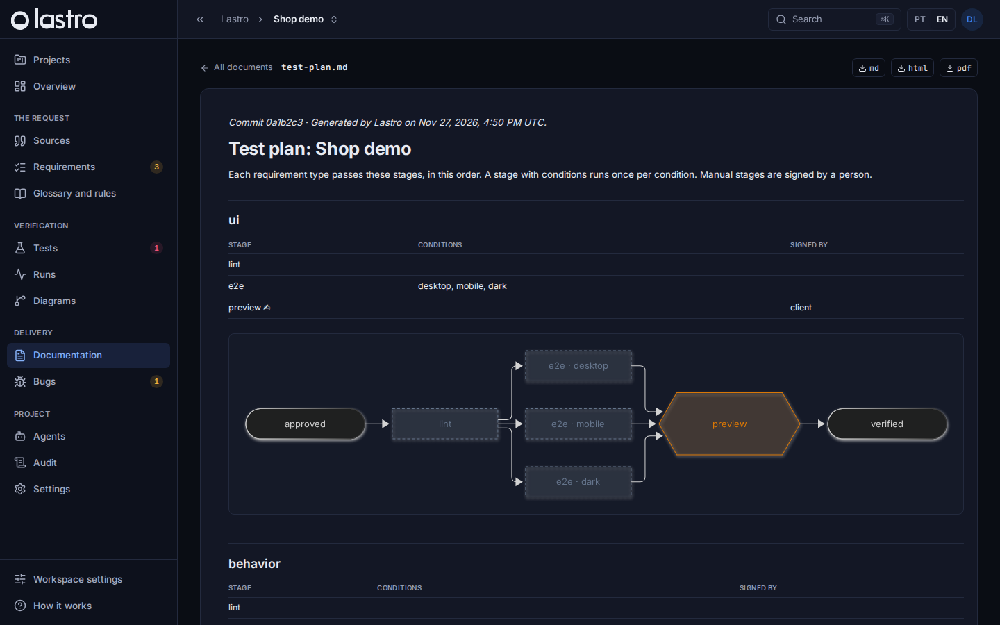

<p>
  <picture>
    <source media="(prefers-color-scheme: dark)" srcset="docs/brand/readme-dark.svg">
    
  </picture>
</p>

**Requisitos, evidência e quality gates para desenvolvimento com IA. Sem lastro, não está pronto.**

[English](README.md) · **Português**

*lastro: aquilo que dá valor e garantia a alguma coisa.*



Com agentes de IA, escrever código deixou de ser o gargalo. O gargalo agora é o caminho entre o que foi pedido e o que foi entregue:

- o pedido chega em pedaços (mensagem, áudio, vídeo, documento, print);
- o agente preenche as lacunas por conta própria e não avisa;
- os testes confirmam a interpretação do agente, não a de quem pediu;
- o que foi combinado se perde entre sessões e compactações;
- quem pediu descobre a diferença em produção.

O Lastro é uma camada open source entre quem pede, o agente que escreve o código e quem aceita a entrega. Um requisito só está pronto quando tem três coisas:

1. **Origem.** A citação literal do pedido, com a âncora: seção, parágrafo, página, mensagem, minuto do vídeo. O Lastro confere a citação contra a fonte.
2. **Aceite.** Critérios com os exemplos e os números de quem pediu, travados quando uma pessoa aprova, para o agente não editar nem eles nem os testes deles.
3. **Evidência.** Uma execução feita pelo próprio Lastro, em todas as condições que o tipo do requisito exige, presa aos arquivos que ele toca. Quando esses arquivos mudam, a evidência vence.

## Como funciona



- **O Postgres é a verdade, e o git recebe a exportação.** Um servidor auto-hospedado guarda todos os projetos. `lastro export` grava um retrato determinístico em `.lastro/`, revisado no mesmo PR que o código.
- **Sem LLM dentro.** Quem pensa é o agente que você já usa. O Lastro guarda, cobra e confere. Sem chave de API, sem custo de token, sem mandar dado de cliente para lugar nenhum.
- **Automático por padrão, pessoa onde importa.** O Lastro aprova e trava um requisito sozinho quando a especificação está completa e todo critério tem seus testes, nos níveis que o tipo exige; vale a versão mais recente de cada fonte. A pessoa responde o que só quem pediu sabe e aceita a entrega. No modo com revisão, a pessoa também aprova cada requisito. Aprovar, aceitar, destravar critério, assinar etapa manual, importar exportação e mudar a configuração de QA são recusados para token de agente no núcleo, não só nos hooks.
- **Testes que provam alguma coisa.** Cada tipo de requisito diz quais testes precisa (unidade, integração, ponta a ponta com Playwright, em cada condição) e quanto do código que ele toca os testes precisam executar (cobertura de funções e linhas, lida do LCOV). O teste precisa falhar numa execução do Lastro antes de passar, e os números de quem pediu precisam estar nele. O requisito só fica verificado quando tudo isso vale.
- **Agnóstico.** Claude Code primeiro, com CLI e servidor MCP para qualquer agente, em qualquer stack cujos testes gerem JUnit e cujos linters gerem SARIF.

## O painel

| | |
|---|---|
|  |  |
| **Requisitos:** a citação ao lado do trecho da fonte, campos, critérios travados, testes por nível, o fluxo de QA ao vivo e o que ainda trava | **Testes:** todo teste visto numa execução, histórico, instáveis, órfãos e critérios sem teste |
|  |  |
| **Execuções:** etapas por condição, resultados dos testes, apontamentos SARIF, saída e comparação com a execução anterior | **Diagramas:** fluxos de QA por tipo, rastreabilidade da fonte ao teste, mapa de módulos e ciclo de vida, gerados dos dados |
|  |  |
| **Configurações:** modo automático ou com revisão, as regras dos testes (vermelho antes do verde, os números de quem pediu, cobertura), níveis de teste por tipo, editor visual de fluxos de QA, condições, comandos e gate; tokens de acesso; membros | **Agentes:** o que cada agente fez em cada sessão, ações recusadas e paradas seguradas pelo gate |

E mais: uma página Como funciona e ajuda em linguagem simples em cada termo, fontes com versões e trechos ancorados, pacotes, decisões e perguntas, bugs com triagem e cobrança, glossário, invariantes e contrato de layout, auditoria só de inclusão, tema claro e escuro, inglês e português.

A **documentação** é gerada dos dados em Markdown, HTML e PDF, e cada documento diz de qual commit e data veio: visão geral, requisitos por pacote, regras de negócio e invariantes, arquitetura, decisões, plano de testes, casos de teste, relatório de qualidade, histórico de entregas, diagramas e um relatório de entrega para quem pediu. `lastro report <PKG>` grava o relatório item a item de um pacote, na ordem e na numeração de quem pediu.



## Três níveis de garantia

| Nível | Como |
|---|---|
| Orientação | O contexto do projeto (requisitos ativos, critérios, glossário, invariantes, decisões, perguntas abertas) volta ao agente no início de toda sessão e depois de toda compactação |
| Controle | Hooks do Claude Code: o agente não encerra a resposta enquanto pode corrigir um gate vermelho, não edita teste travado nem a exportação `.lastro/`, não roda comando humano |
| Bloqueio externo | `lastro gate` num hook `pre-push` e como check obrigatório no CI (GitHub Action incluída) |

## Começando

**1. Servidor** (painel, API e endpoint MCP), numa máquina com Docker:

```bash
git clone https://github.com/srnakyo/lastro.git && cd lastro
cp .env.example .env      # defina LASTRO_URL, BETTER_AUTH_SECRET e POSTGRES_PASSWORD
docker compose -f docker/compose.prod.yml --env-file .env up -d
```

Abra o `LASTRO_URL`, crie sua conta e o workspace, depois um projeto (**Projetos › Novo projeto**).

**2. CLI** no seu repositório:

```bash
npm install -g @nakyo/lastro
lastro login --url https://lastro.exemplo.com   # abre o navegador: você autoriza esta máquina, uma vez
lastro init meu-app           # liga esta pasta ao projeto
lastro intake "pedido v4.docx"
lastro pending
lastro verify REQ-K7Q2M
lastro gate
lastro docs build --format md,pdf --lang pt-BR
lastro install-hooks          # o pre-push do git roda lastro gate
```

**3. Claude Code:**

```
/plugin marketplace add srnakyo/lastro
/plugin install lastro@lastro
```

O plugin usa o `lastro login` da máquina. Ele traz os hooks, o servidor MCP `lastro` e as skills `/lastro:intake`, `/lastro:spec`, `/lastro:build`, `/lastro:report` e `/lastro:triage`. Outros agentes se conectam pelo `lastro mcp` (stdio) ou pelo `/api/mcp` em HTTP com token Bearer.

**4. CI e revisão:** a [GitHub Action](packages/adapters/github-action) roda `lastro verify` e `lastro gate`, com resumo no job. Os [modelos do Claude Ship](packages/adapters/claude-ship) trazem um `REVIEW.md` para o Claude Code Review e uma política do Claude Approvals com o classificador `lastro_scope`.

### Como a CLI se conecta

**Um login por máquina.** O `lastro login` abre o painel no navegador, mostra um código para você comparar com o do terminal e pede para você **Autorizar**. A máquina recebe um token de agente que vale para todos os projetos do workspace, guardado em `~/.config/lastro/credentials.json`, fora de qualquer repositório. Cada repositório diz qual é o seu projeto (`server.project` no `.lastro/lastro.yml`, gravado pelo `lastro init`), então o mesmo login vale em todos os repositórios e nada é trocado entre eles.

**Por que token, mesmo no localhost.** O token diz ao Lastro quem está chamando: você, no painel, ou o agente, pela CLI e pelo Claude Code. O token do agente registra requisitos, roda testes e manda resultados; o Lastro recusa a ele o que é de pessoa (aprovar, aceitar, destravar, responder), que você faz no painel. É isso que impede o agente de aprovar o próprio trabalho, no localhost como num servidor.

**Projeto é coisa de pessoa.** Crie no painel; o `lastro init <chave>` liga uma pasta a ele.

**Token à mão** é para o que não tem navegador. Em **Configurações gerais › Tokens de acesso**: um token para todos os projetos, para o CI (`LASTRO_URL` e `LASTRO_TOKEN` como segredos) ou para o `lastro login --token` num servidor. Nas **Configurações › Tokens de acesso** de um projeto: um token que vale só nele; a CLI guarda esse token para o projeto e usa na pasta dele. Token de pessoa age como você no terminal, só para rodar lá os comandos de pessoa. Revogue qualquer token nos mesmos lugares.

## Desenvolvimento

Precisa de [Bun](https://bun.sh) 1.3, Node 22 e Postgres 16 (ou `docker compose -f docker/compose.dev.yml up -d`).

```bash
bun install
cp .env.example .env                      # aponte LASTRO_DATABASE_URL e LASTRO_TEST_DATABASE_URL para o seu Postgres
(cd packages/database && bunx prisma migrate deploy && bunx prisma generate)
(cd apps/web && bun run dev)              # http://localhost:4317
bun scripts/seed-dev.ts                   # dev@lastro.local / lastro-dev-password, com o projeto shop-demo
bun run test                              # testes de unidade e integração no banco lastro_test
bunx playwright test                      # as telas de verdade, no computador e no celular
bunx eslint . && bun audit
```

| Pasta | O que é |
|---|---|
| `apps/web` | Painel, API REST (`/api/v1`) e endpoint MCP (`/api/mcp`): TanStack Start |
| `packages/core` | Serviços de domínio, uma pasta por domínio; toda operação recebe o projeto |
| `packages/database` | Esquema e migrações do Prisma, auditoria só de inclusão garantida por trigger |
| `packages/shared` | Contratos zod usados pela API, pela CLI, pelo MCP e pela exportação |
| `packages/cli` | O comando `lastro`; fala com a API, nunca com o banco |
| `packages/runner` | Roda os comandos do projeto por condição, lê JUnit e SARIF |
| `packages/intake` | Extratores de fonte: Markdown, DOCX com as imagens na ordem, PDF, conversas exportadas, áudio e vídeo |
| `packages/storage` | Armazenamento local ou compatível com S3 para fontes, imagens e documentos |
| `packages/docs` | Geradores dos documentos e dos diagramas Mermaid, renderização em HTML e PDF |
| `packages/adapters` | Plugin do Claude Code, hook do git, GitHub Action, modelos do Claude Ship |

O [PRD](docs/pt-BR/prd/README.md) descreve o produto: o problema, o modelo de dados, o ciclo de vida, os fluxos de QA e a arquitetura. O [ROADMAP](ROADMAP.md) acompanha a construção. [`.lastro/`](.lastro) é o próprio Lastro, descrito no formato dele.

## Contribuindo

Issues e pull requests são bem-vindos: conte como a distância entre pedido e entrega aparece no seu dia a dia, ou proponha um adaptador para o seu agente ou stack. Leia o [CLAUDE.md](CLAUDE.md) para as regras que o código segue.

## Licença

[MIT](LICENSE)
