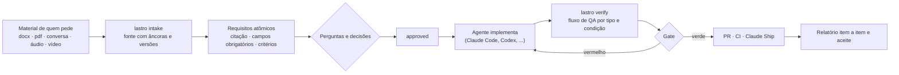

# Lastro

**Requisitos, evidência e quality gates para desenvolvimento com IA. Nada fica pronto sem lastro.**

[English](README.md) · **Português**

> **Status:** em desenho. O [PRD](docs/pt-BR/prd/README.md) está aberto para discussão. Ainda não há código.

---

*lastro (pt-BR): o que garante que algo vale o que diz valer.*

Com agentes de IA, escrever código deixou de ser o gargalo. O gargalo virou o caminho entre o que foi pedido e o que foi entregue:

- o pedido chega em pedaços (mensagem, áudio, vídeo, documento, print);
- o agente preenche os buracos sozinho e não avisa;
- os testes confirmam a interpretação do agente, não a de quem pediu;
- o que foi combinado se perde entre sessões;
- quem pediu descobre a diferença em produção.

O Lastro é uma camada open source entre quem pede, o agente que escreve o código e quem aceita a entrega. Um item só fica pronto quando tem três coisas:

1. **Origem.** A citação literal do pedido, com a âncora: página, mensagem, minuto do vídeo.
2. **Aceite.** Critérios escritos com os exemplos e números de quem pediu, travados para o agente não editar.
3. **Evidência.** O resultado de uma execução feita pelo próprio Lastro, no commit atual, nas condições de uso reais.

## Como funciona



- **Tudo fica no repositório**, em `.lastro/`, revisado no mesmo PR que o código.
- **Sem LLM dentro.** Quem pensa é o agente que você já usa. O Lastro guarda, cobra e confere.
- **Local primeiro.** Sem servidor, sem conta, sem assinatura.
- **Agnóstico.** Claude Code primeiro, com CLI e MCP para qualquer agente, em qualquer stack que gere JUnit ou SARIF.

## Três níveis de garantia

| Nível | Como |
|---|---|
| Orientação | Contexto do projeto injetado em toda sessão e depois de toda compactação |
| Controle | Hooks do agente: não encerra com o gate vermelho, não edita teste travado, não aprova a própria spec |
| Bloqueio externo | `pre-push`, check obrigatório no CI e proteção de branch |

## Como vai ser usar

```bash
npm install -g lastro      # ainda não publicado

lastro init
lastro setup claude        # MCP, hooks e CLAUDE.md
lastro intake "Correções v.4.docx"
lastro pending
lastro approve PKG-2R8XW
lastro verify
lastro gate
lastro report PKG-2R8XW --format pdf
```

## Documentação

- [PRD](docs/pt-BR/prd/README.md): o problema, o modelo de dados, o ciclo de vida, os fluxos de QA, as integrações e o roteiro.
- [`.lastro/`](.lastro): o MVP do próprio Lastro, descrito no formato que ele propõe.

## Contribuindo

O projeto está na fase de desenho. Abra uma issue para discutir o PRD, contar como o problema aparece no seu fluxo ou propor um adaptador para o seu agente ou stack.
