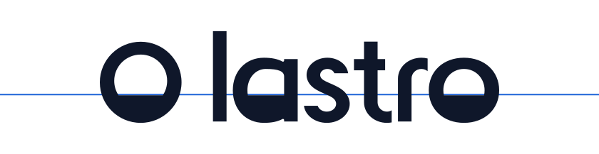

# Lastro, arquivos da marca

[English](README.md) · **Português**

A ideia: todo vaso da marca está cheio até a mesma linha, o nível. O símbolo, o a e o o têm o chão na mesma altura (42% da altura de x). O símbolo pisa na linha de base, mede 1,3 altura de x e o peso enche um terço dele.

## Qual arquivo usar

| Arquivo | Uso | Tamanho |
|---|---|---|
| `lockup.svg` | Assinatura horizontal (símbolo e palavra). Site, PDF, telas grandes. | proporção 3177 × 735; a partir de 24 px de altura |
| `lockup-sidebar.svg` | Versão ajustada no pixel para a barra lateral, 30 px de altura com altura de x de 20 px (só retas: base, altura de x, nível e hastes caem no pixel; as curvas continuam círculos e elipses verdadeiros). Usar 1:1, em posição de pixel inteiro. A linha de base fica em y = 29 a partir do topo. | 127 × 30 px |
| `wordmark.svg` | Só a palavra, quando o símbolo já está perto (ex.: rodapé com o favicon ao lado). | 2277 × 735 |
| `mark.svg` | Símbolo mestre. Ícones a partir de 40 px, app, impressão. | 1000 × 1000 |
| `mark-28.svg` | Símbolo desenhado no pixel para 28 px (barra recolhida): paredes de 5 px, chão na linha 10. Serve de 24 a 32 px. | 28 × 28 |
| `favicon.svg` | Aba do navegador, 16 px na grade de pixel: paredes de 3 px, chão na linha 6. Cores explícitas: tinta no claro, claro no escuro (`prefers-color-scheme`). | 16 × 16 |
| `readme-light.svg` / `readme-dark.svg` | Cabeçalho do README com a linha azul do nível. Fundo transparente, cores explícitas para #ffffff e #0d1117. | 840 × 218 |
| `avatar.png` | Avatar quadrado de GitHub e npm. Aguenta o recorte redondo. | 512 × 512 |
| `social-preview.png` | Prévia social do repositório no GitHub (Settings, Social preview). | 1280 × 640 |

Os SVG usam `fill="currentColor"` (menos favicon e readme). Inline, a cor vem do CSS (`color`). Dentro de `` o currentColor vira preto: nesse caso use o SVG inline ou troque o fill.

README com tema claro e escuro:

```html
<picture>
  <source media="(prefers-color-scheme: dark)" srcset="readme-dark.svg">
  
</picture>
```

Favicon: `<link rel="icon" href="/favicon.svg" type="image/svg+xml">`.

No código, o painel e os documentos desenham os mestres (`mark.svg`, `lockup.svg`) a partir de `packages/shared/src/brand.ts`, gerado por `bun scripts/brand.ts`, que também copia o favicon para `apps/web/public/`. Depois de mudar qualquer SVG daqui, rode o script.

Terminal: não desenha vetor. A assinatura em texto é `◒ lastro` (U+25D2), na fonte do terminal. Status: verde #16a34a (pronto), vermelho #dc2626 (recusado).

## Cores

| Nome | Hex | Uso |
|---|---|---|
| Tinta | #0f172a | a marca no claro |
| Claro | #e6ebf3 | a marca no escuro (#0b1220) |
| Azul | #1d63d8 | só a linha do nível |
| Verde | #16a34a | status pronto (CLI, painel) |
| Vermelho | #dc2626 | status recusado (CLI, painel) |

A marca é sempre de uma cor só. Sem degradê, sombra, contorno ou caixa em volta.

## Respiro

- Assinatura: no mínimo a altura de x da palavra em volta (cerca de 3/4 do diâmetro do símbolo).
- Símbolo sozinho: 25% do diâmetro em volta.

## Tamanhos mínimos

- `lockup.svg`: 24 px de altura. Na barra lateral, `lockup-sidebar.svg` em 30 px.
- `mark.svg`: 40 px. De 24 a 39 px, `mark-28.svg`. Em 16 px, `favicon.svg`.
- `wordmark.svg`: altura de x de 9 px.

## A linha do nível

A linha azul passa exatamente sobre o chão dos vasos e atravessa a largura toda. Ela só aparece em peças grandes (README, prévia social, avatar, apresentação). Nunca nos tamanhos pequenos, nunca em outra cor.

## Medidas (unidades sobre altura de x = 500)

- Nível 210 (42%). Ascendente 724. Sobra das curvas 11. Haste 108 (21,6%). Horizontais 90.
- Espaço entre letras: 50 no ponto de tinta mais próximo (10% da altura de x). Símbolo até a palavra: 250 (50%).
- Símbolo: diâmetro 650 (1,3 altura de x), pisa na linha de base com sobra de 11. Paredes 176 nos lados e 158 em cima (em 1000). Chão a 34% do diâmetro.
- Assinatura da barra lateral (pixels): altura de x 13, nível 6, ascendente 19, hastes 3, símbolo de 17 com chão na linha 6, 7 px até a palavra, cerca de 2 px de ar entre letras.
- Todo corte reto está no nível ou no prumo: o s cortado no nível, o pé do t e o braço do r no prumo. O chão dos vasos é um corte seco, sem arredondar.

## Qualidade do desenho (todos os SVG)

- Um path por arquivo (os README têm dois: a linha e a marca), coordenadas absolutas, sem transform, no máximo 2 casas decimais.
- Contornos desenhados nó a nó, sem operação booleana: arcos de elipse partidos nos extremos (todo extremo horizontal e vertical é um nó), cada subpath fecha exatamente no ponto de partida, sem segmento de comprimento zero.
- Contraformas no sentido oposto ao contorno externo (preenchimento nonzero).
- O s tem a espinha em curva contínua: a curvatura da espinha começa igual à da barriga (G2) e inverte no meio, sem reta e sem quina.
- No a, a barriga cresce para a haste e encontra a haste quase no nível, com um arredondado pequeno no encaixe (sem V); a contraforma encontra a haste no prumo.
