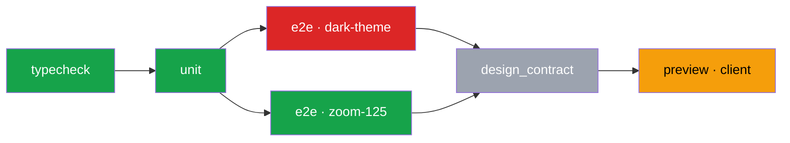
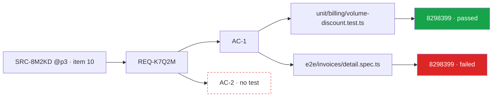

# 3. Dashboard, documentation and diagrams

The dashboard is where everything Lastro stores becomes visible and organized:

- what was asked for and where it came from;
- what was tested, under which conditions and with what result;
- what failed and why;
- what is still missing, and who it depends on;
- the project's documentation, generated from that data.

It is the centerpiece of the product. The CLI, the MCP and the hooks feed the data; the dashboard is where people look, decide and generate the documents.

## Two ways to run it

| Mode | Command | Database | For whom |
|---|---|---|---|
| **Local** | `lastro ui` | SQLite in `.lastro/.state/`, no setup | One developer, on their own machine. Listens only on `127.0.0.1`, no login |
| **Server** | `lastro server` | Postgres (see [Storage](04-domain-model.md#storage)) | A team, several projects and everyone's history in one place. With login, and CI writes to it with a token |

The dashboard is the same in both modes. Only where it reads from changes.

## Organization

Everything follows the same hierarchy, from the broadest to the most detailed:

```
Project → Package (delivery round) → Requirement → Acceptance criterion → Test → Run → Evidence
```

Every list can be filtered by:

- state and type;
- module;
- condition;
- period and commit;
- who decided.

The global search finds anything by ID, by a passage of the quote or by the test name.

## Pages

| Page | What it shows |
|---|---|
| **Overview** | Project indicators: requirement coverage by tests, tests run, passed, failed and pending, each package's gate, quality by module, latest runs and open incidents |
| **Packages** | Each delivery round with the items in the requester's numbering, the funnel by state and what is missing. "Pending" here is only what hasn't been verified |
| **Requirement** | The quote side by side with the source passage, the fields, the criteria, each criterion's tests by condition, the evidence by commit, the decisions, the questions and the state history |
| **Tests** | The catalog of every test in the project (detailed below) |
| **Runs** | Every `lastro verify` and every CI run (detailed below) |
| **Diagrams** | The live diagrams of the project, the package and the requirement (see the next section) |
| **Documentation** | Generate, view and download the project's documents (see further below) |
| **Sources** | The documents, conversations, audio and video received, with their versions, the difference between them and the requirements each passage generated |
| **Questions and decisions** | What is open, what the agent assumed and hasn't been confirmed yet, what the client answered |
| **Incidents** | Complaints after delivery, with triage, cause and billing (fix, courtesy or quote) |
| **Configuration** | QA flows, conditions, glossary and layout contract. The flows are edited visually: add, remove and reorder stages and conditions |
| **Projects** | Server mode only: every project in the database, side by side, with the same indicators |

### Tests page

- Every test in the project, identified as `file::test name`, with the criteria and requirements it covers.
- The history of results by commit and by condition, with the duration of each run.
- **Flaky tests:** they pass and fail with no change to the code they cover.
- **Orphan tests:** they exist in the project but don't cover any criterion.
- **Criteria without tests:** the list of what still has no way to be verified.

### Runs page

Each run shows:

- who triggered it (dev, agent or CI), the commit and the branch;
- the stages and the conditions, in order, with the result of each one;
- the command that ran, the output, the duration and the exit code;
- the attached screenshots, videos and reports;
- the comparison with the previous run of the same requirement: what started failing and what started passing again.

## Live diagrams

The diagrams are generated from the data, never drawn by hand, so they never go out of date.

- They are written in Mermaid and rendered in the dashboard.
- Clicking an element opens the item.
- The same diagrams go into the generated documentation, as Mermaid and SVG.

### A requirement's QA flow, with the result

Each stage, under each condition, colored by the latest result on the current commit:



Green passed, red failed, gray didn't run because an earlier stage failed, and orange is waiting for a person.

### Traceability

From the source to the evidence, with the gaps highlighted:



What shows up as a gap:

- a criterion without a test;
- a test with no run on the current commit;
- a quote that doesn't match the source;
- a requirement without a final source.

### Package lifecycle

The state diagram of the [lifecycle](05-lifecycle-and-gates.md), with the number of items in each state and the transitions that are blocked.

### Module map

The system's modules, with how many requirements and incidents each one has. It comes from `reach.modules` and from the files in `touches`. It shows where the project breaks the most.

### Timelines

Charts, not diagrams:

- results by commit and by day;
- incidents by package, split by cause (incomplete spec, implementation, regression);
- items reopened by package.

## Generated documentation

`lastro docs build` generates the documentation from the data, never from the agent's memory. The dashboard has the same button.

| Document | Content |
|---|---|
| **Project overview** | Packages, modules, glossary and overall numbers |
| **Requirements** | By module: origin, rule, fields, criteria and state |
| **Business rules and invariants** | The glossary and the invariants, with the tests that protect them |
| **Decisions** | Every decision, with the reason and who decided |
| **Test plan** | The QA flows by type, the conditions and the commands |
| **Test cases** | The catalog, with what each test covers |
| **Quality report** | Indicators, tests run, failures and pending items, by package or by period |
| **Delivery history** | By package: what went in, with the evidence |
| **Client report** | Item by item, in the requester's numbering (see [Packages and the item-by-item report](05-lifecycle-and-gates.md#packages-and-the-item-by-item-report)) |
| **Diagrams** | The live diagrams above, in Mermaid and SVG |

- Formats: Markdown, HTML and PDF.
- The PDF accepts the developer's logo, colors and cover.
- The Markdown files can go into the repository, in `docs/lastro/`, if the project configures it.
- Every document states the commit and the date it was generated from. Generated again in CI, it keeps up with the code.

## Human actions in the dashboard

From the dashboard, a person can:

- approve a spec;
- confirm or overturn a decision;
- answer a question;
- record a preview and a manual stage;
- accept a delivery;
- triage an incident;
- edit the QA flows.

These are the same human actions as in the CLI, and the agent has no access to any of them.

- **In local mode,** the action writes directly to the files in `.lastro/` and goes into the next commit.
- **In server mode,** the action becomes an event in Postgres. `lastro sync` applies the event to the repository's files, so the spec is still reviewed in the PR.

## Visual design

- React, with Tailwind and shadcn/ui.
- Light and dark theme.
- Works on laptop and phone screens.
- Confirmations through its own dialog, never through the browser's native boxes.
- Diagrams in Mermaid; charts in Recharts.
