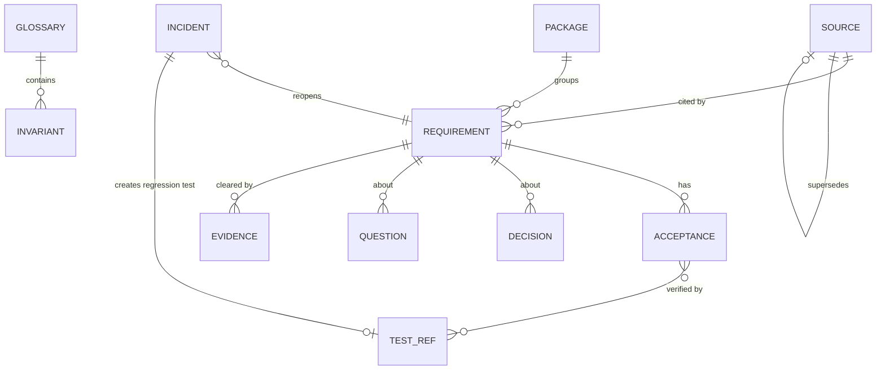

# 3. Data model and file format

## Where everything lives

```
.lastro/
  lastro.yml            configuration: types, required fields, QA flows, conditions, gate
  glossary.yml          domain terms and invariants
  design.yml            layout contract
  sources/              one source per file (metadata + extracted text with anchors)
  requirements/         one requirement per file
  decisions/            assumptions and decisions
  questions/            open and answered questions
  incidents/            complaints and defects after delivery
  packages/             delivery rounds (e.g. "Fixes v.4")
  ledger/               the latest evidence that cleared each requirement (small, versioned)
  .store/               source binaries and artifacts (out of git by default)
  .state/               SQLite index and full run history (out of git)
  .out/                 temporary command output (out of git)
```

- What is in YAML and Markdown is the truth and goes into git, reviewed in the same PR as the code.
- SQLite is only an index and history. It can be deleted and rebuilt.
- `lastro.yml` has `version: 1` at the top, and every file is validated by a published JSON Schema, so editors can flag typos.

## IDs

- Format `<PREFIX>-<5 base32 characters>`, for example `REQ-K7Q2M`, `DEC-3F9TA`. Random, so they don't collide when two branches create items at the same time.
- The client's numbering ("item 14 of the document") doesn't become an ID: it stays in the source anchor and shows up in the report.
- Prefixes: `SRC` source, `REQ` requirement, `AC` criterion (local to the requirement), `DEC` decision, `Q` question, `INC` incident, `PKG` package, `ART` artifact, `INV` invariant.

## Entities



### Source (`sources/SRC-xxxxx.yml`)

Everything that comes from the requester: document, conversation, audio, video, screenshot, meeting.

```yaml
id: SRC-8M2KD
kind: docx            # docx | pdf | chat | audio | video | image | meeting | text
title: "Fixes v.4.docx"
from: client          # client | dev | team
received_at: 2026-11-14T15:17:00-03:00
hash: sha256:9f1c...  # of the original file, stored in .store/
version: 2
supersedes: SRC-4TQ7B # previous version with the same name
final: true           # only final sources can back an approved requirement (configurable)
extracted: SRC-8M2KD.md   # extracted text with anchors, next to this file
machine_transcript: false # true for transcribed audio and video: the quote needs confirmation
```

For a source that already lives in the repository (a PRD, a Markdown spec), `path` points to the file or folder instead of `extracted`, and anchors use the file and the section heading.

The extracted text (`SRC-8M2KD.md`) marks the anchors like this:

```markdown
<!-- @p3 -->
10. Invoices: the volume discount has to show on the invoice, including the annual plan. Today it only shows on the monthly one.
<!-- @p3/img2 -->

```

Anchors by type:

| Type | Anchor |
|---|---|
| docx | paragraph and image in document order (`@p3`, `@p3/img2`) |
| pdf | page and block (`@pg12/b4`) |
| chat | message id (`@msg:3A5B...`), with author and time |
| audio, video | minute and second (`@t00:34`); for video, also the extracted frame |
| image | the whole image (`@img`) |
| text (a file in the repository itself) | file and section heading (`@04-lifecycle-and-gates.md#requirement-states`) |

### Requirement (`requirements/REQ-xxxxx.yml`)

The unit of work. Atomic: one verifiable behavior.

```yaml
id: REQ-K7Q2M
title: "Volume discount shows up on the annual plan invoice"
type: calculation     # types defined in lastro.yml
status: specified     # see the lifecycle
package: PKG-2R8XW
sources:
  - ref: SRC-8M2KD
    anchor: "@p3"
    label: "item 10"   # the requester's numbering
    quote: "the volume discount has to show up on the invoice, including on the annual plan"
statement: >
  The invoice shows a "Volume discount" line with the percentage and the amount
  discounted, on monthly and annual plans, whenever the account goes past the minimum tier.
where: "Finance › Invoices › invoice detail (screen and PDF)"
who:
  sees: [owner, billing_admin]
  uses: [billing_admin]
  scope: account       # data scope: own | team | account | all
data_source: "discount tier table in effect on the issue date"
period: "the invoice's billing cycle"
reach:
  modules: [invoices, invoice_pdf, billing_email]
  tenants: all         # all | list
visual_ref: [ART-5HQ2C]
when_missing: "if no tier is reached, the line doesn't appear; never show a zero discount"
examples:
  - given: "annual plan of R$ 12,000, 60 licenses, 50+ license tier = 8%"
    expect: "line 'Volume discount 8%' of R$ 960.00 and a total of R$ 11,040.00"
acceptance:
  - id: AC-1
    text: >
      Given an annual plan of R$ 12,000 with 60 licenses and the 8% tier starting at 50,
      when the invoice is issued,
      then the screen and the PDF show "Volume discount 8%" of R$ 960.00 and a total of R$ 11,040.00.
    tests: ["unit/billing/volume-discount.test.ts::annual plan 60 seats",
            "e2e/invoices/detail.spec.ts::discount line"]
    locked: sha256:41aa...   # filled in by `lastro lock`
decisions: [DEC-3F9TA]
questions: []
depends_on: []
touches: []            # changed files, filled in by Lastro from git
```

Fields every requirement has: `id`, `title`, `type`, `status`, `sources` (with `quote`), `statement`, `acceptance`.

The other fields are **required by type**, as set in `lastro.yml`. Starting examples:

| Type | Required beyond the basics |
|---|---|
| `visual` | `where`, `visual_ref`, `who` |
| `calculation` | `data_source`, `period`, `examples`, `reach`, `when_missing` |
| `permission` | `who`, `reach` |
| `import` | `data_source`, `examples`, `when_missing` |
| `integration` | `data_source`, `when_missing` |
| `behavior` | `where`, `who` |

### Acceptance criterion (inside the requirement)

- Written in the **Given / when / then** format, or in the requester's own format ("how it is, how it should be, how to check").
- Uses the requester's examples and numbers whenever they exist.
- Points to one or more tests (`tests`) or to a manual stage of the flow.
- `lastro lock` records the hash of the criterion text and of the linked tests. From then on, changing a criterion or a test requires a human command (see [Making the agent comply](05-enforcement.md)).

### Decision (`decisions/DEC-xxxxx.yml`)

```yaml
id: DEC-3F9TA
about: [REQ-K7Q2M]
kind: assumption       # assumption | decision | client_answer
text: "The request doesn't say whether the discount shows in the billing email. Adopted: it does, same as the screen and the PDF."
reason: "The email repeats the invoice summary; a total different from the PDF would confuse the end customer."
decided_by: agent      # agent | dev | client
status: proposed       # proposed | confirmed | overturned
show_to_client: true   # shows up in the report as "we decided"
source: null           # for client_answer: the message or document with the answer
```

- An agent's assumption starts as `proposed` and doesn't block the item.
- The developer confirms or overturns it. Overturning reopens the requirement.
- In the client report, the decision shows up as a statement: "We decided to show the discount in the billing email too, because the request didn't say and the email repeats the invoice".

### Question (`questions/Q-xxxxx.yml`)

```yaml
id: Q-7WD2P
about: [REQ-K7Q2M]
text: "If the account drops below the tier mid-cycle, does the discount apply until the end of the cycle or is it recalculated?"
blocks: true           # blocks the requirement before 'approved'
asked_to: client
asked_via: "whatsapp"
asked_at: 2026-11-16T10:02:00-03:00
answer: null
answer_source: null    # e.g. SRC-9Q3LM @msg:3EB0...
```

- A question with `blocks: true` blocks only its own requirement, not the package.
- Once answered, the answer becomes a `client_answer` decision with its source.

### Incident (`incidents/INC-xxxxx.yml`)

Every complaint after delivery.

```yaml
id: INC-2B8KV
reported: "Why didn't the discount show up on the annual invoice PDF?"
source: { ref: SRC-6TT9A, anchor: "@msg:3A9F..." }
triage: bug            # bug | config | missing_data | usage | improvement | not_a_defect
cause: spec_gap        # spec_gap | implementation | regression | client_change | environment
requirement: REQ-K7Q2M
regression_test: "e2e/invoices/pdf.spec.ts::discount on annual plan"
billing: fix           # fix | courtesy | quote
```

- `triage` answers whether it is a real defect.
- `cause` answers "did we get it wrong or was the scope incomplete?".
- `billing` answers whether it is a fix, a courtesy or goes into a quote.
- An incident with `triage: bug` requires a `regression_test` before the requirement can go back to `verified`.

### Package (`packages/PKG-xxxxx.yml`)

A delivery round: a document of fixes, a batch of messages, a release.

```yaml
id: PKG-2R8XW
title: "Fixes v.4"
sources: [SRC-8M2KD]
opened_at: 2026-11-14
closed_at: null
report: true           # generates an item-by-item report for the client
```

### Glossary and invariants (`glossary.yml`)

```yaml
terms:
  - term: "Gerente"
    means: "the system's Manager role"
    note: "the requester says 'gerente'; in the code and the database the role is called manager"
  - term: "active customer"
    means: "account with a confirmed payment in the last 30 days"
invariants:
  - id: INV-1
    text: "Every record of a person with access creates a real login account."
    tests: ["e2e/users/real-account.spec.ts"]
  - id: INV-2
    text: "Business rules and permissions are computed in the API; the front end only displays them."
```

An invariant with `tests` joins the gate of every requirement that touches the same files.

### Layout contract (`design.yml`)

```yaml
components:
  modal: "app-modal"
  tabs: "app-tabs"
  kpi: "app-kpi"
  filter_bar: "app-filter-bar"
forbidden:
  - "a window, card or color outside these components"
  - "two filter styles in the same application"
palette:
  primary: "#1F6FEB"
  accent: "#F59E0B"
reference_screens: [ART-1KQ8D, ART-7PM3X]
```

The contract goes into the agent's context, generates the layout section of `REVIEW.md` and can be checked by a check in the `visual` flow.

### Evidence (`ledger/REQ-xxxxx.json` and `.state/`)

Every run performed by Lastro records:

```json
{
  "requirement": "REQ-K7Q2M",
  "stage": "e2e",
  "condition": "member-profile",
  "commit": "8298399",
  "tree": "sha1 of the tree of the files in 'touches'",
  "command": "npx playwright test e2e/invoices --reporter=junit",
  "exit_code": 0,
  "started_at": "2026-11-25T14:02:11Z",
  "duration_ms": 41210,
  "results": { "passed": 6, "failed": 0, "skipped": 0 },
  "artifacts": ["ART-9XQ1T"],
  "by": "lastro"
}
```

- The full history lives in SQLite.
- `ledger/` keeps only the evidence that cleared each requirement at delivery, for the PR and the report.
- Artifacts (screenshots, videos, long output) live in `.store/` by hash. They can go into git or LFS if the project configures it.

## What is sensitive

Client material often contains personal data. By default:

- the source binary stays in `.store/`, out of git;
- the extracted text goes into git (configurable: `sources.commit: text | none | all`);
- Lastro never sends anything off the machine. If material goes to an LLM, the agent sends it, under its own rules.
