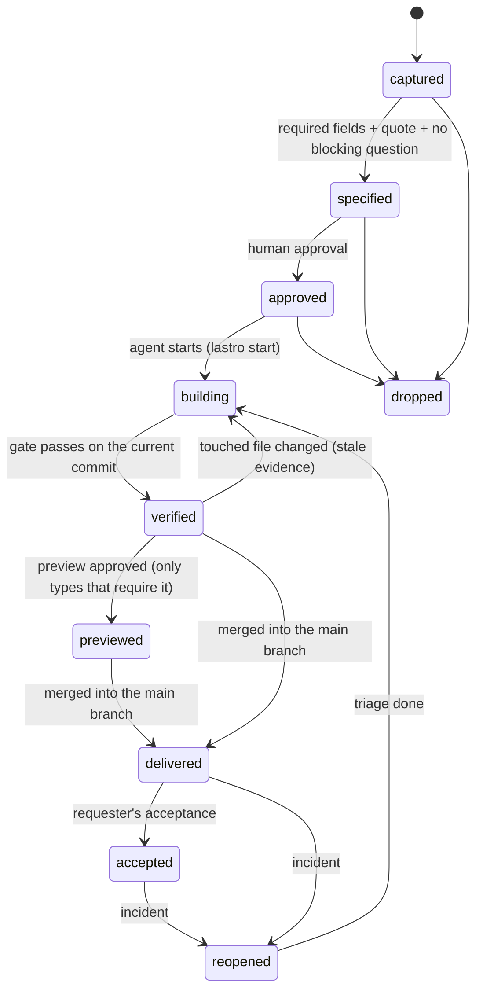

# 5. Lifecycle, gate and QA flows

## Requirement states



| State | Meaning | Who moves it |
|---|---|---|
| `captured` | Item extracted from the source, still incomplete | Agent or person |
| `specified` | The type's required fields are filled in, the quote is anchored, no blocking question is open | Lastro, when the conditions are met |
| `approved` | Spec accepted for implementation | Person (dev, client or both, as set in `lastro.yml`) |
| `building` | Being implemented, with a registered branch | Agent |
| `verified` | Gate green on the current commit | Lastro |
| `previewed` | Visual preview approved by whoever has to approve it | Person, with the approval reference |
| `delivered` | The verified commit is on the main branch (or in the release tag) | Lastro, reading git |
| `accepted` | The requester accepted it | Person, with the acceptance reference |
| `reopened` | An incident reopened the item | Lastro, when the incident is recorded |
| `dropped` | Out of scope, with a reason | Person |

**Pending is only what hasn't reached `verified`.** The dashboard and the `lastro pending` command never list a verified item as pending, nor as "still needs to go to production".

## What unlocks each transition

### `captured` → `specified`

- All the type's required fields are filled in.
- Every `quote` exists literally in the source's extracted text, at the given anchor. Lastro checks. An invented quote is rejected.
- No question with `blocks: true` is open.
- If the source is `machine_transcript: true`, the quote was confirmed by a person.

### `specified` → `approved`

- Human command: `lastro approve REQ-K7Q2M`, or the whole package (`lastro approve PKG-2R8XW`).
- If `lastro.yml` requires a final source (`approval.require_final_source`), every cited source has `final: true`. A requirement can be specified from a draft, but only approved from the final version.
- The agent doesn't have this command (see [Making the agent comply](06-enforcement.md)).
- Approving locks the acceptance criteria (automatic `lastro lock`).

### `building` → `verified` (the gate)

A requirement's gate passes when, **on the current commit**:

1. Each acceptance criterion has at least one linked test, and all linked tests passed in a run performed by Lastro.
2. Each stage of the type's QA flow passed, under each condition the stage requires.
3. The project's global commands passed (typecheck, lint, unit tests), as set in `lastro.yml`.
4. No locked criterion or test changed since the `lock`.
5. The regression tests from incidents linked to the requirement passed.
6. The invariants whose tests touch the same files passed.
7. No linked decision is `overturned`.

The evidence applies to the tree of the files in `touches`. If any of them changes afterwards, the requirement goes back to `building` with the reason "stale evidence".

### `verified` → `previewed`

- Only for types whose flow has the `preview` stage (by default, `visual`).
- Lastro generates the artifact (screenshots of the required screens and conditions) and the developer records who approved it and where: `lastro check REQ-K7Q2M preview --pass --by client --ref "whatsapp @msg:3EB0..."`.

### `delivered` → `accepted`

- Explicit acceptance, with a reference.
- Or tacit acceptance after N days with no incident, if the project configures it (`acceptance.tacit_after_days`).

## Configurable QA flows

The QA flow for each requirement type lives in `lastro.yml`. It can be edited by hand, through the CLI (`lastro flow ...`) or through the dashboard.

```yaml
version: 1
project: "my-app"
language: pt-BR

approval:
  spec: [dev]              # roles that approve the spec: dev, client or both
  require_final_source: true

commands:                  # the project's own commands; Lastro runs them and reads the result
  typecheck: { run: "npm run typecheck" }
  lint:      { run: "npx eslint . -f @microsoft/eslint-formatter-sarif -o .lastro/.out/eslint.sarif", report: { sarif: ".lastro/.out/eslint.sarif" } }
  unit:      { run: "npx vitest run --reporter=junit --outputFile=.lastro/.out/unit.xml", report: { junit: ".lastro/.out/unit.xml" } }
  e2e:       { run: "npx playwright test --reporter=junit", env: { PLAYWRIGHT_JUNIT_OUTPUT_NAME: ".lastro/.out/e2e.xml" }, report: { junit: ".lastro/.out/e2e.xml" } }

conditions:                # real usage conditions, reused by the flows
  member-profile:       { env: { E2E_PROFILE: "member" }, note: "regular user, no management role" }
  multi-tenant:         { env: { E2E_PROFILE: "member-2-tenants" }, note: "person with access to two accounts" }
  real-volume:          { setup: "npm run db:seed:volume", note: "anonymized database at production size" }
  dark-theme:           { env: { E2E_THEME: "dark" } }
  zoom-125:             { env: { E2E_ZOOM: "1.25" } }
  empty-tenant:         { setup: "npm run db:seed:empty-tenant", note: "new account, nothing configured" }

types:
  calculation:
    required: [data_source, period, examples, reach, when_missing]
    flow:
      - typecheck
      - unit
      - { check: examples, note: "each numeric example becomes a test and passes" }
      - { check: source_reconciliation, manual: true, by: dev, note: "one real case checked against the original source (spreadsheet, BI, document)" }
  permission:
    required: [who, reach]
    flow:
      - unit
      - { run: e2e, conditions: [member-profile, multi-tenant] }
  visual:
    required: [where, visual_ref, who]
    flow:
      - typecheck
      - { run: e2e, conditions: [dark-theme, zoom-125] }
      - { check: design_contract }
      - { check: preview, manual: true, by: client }
  import:
    required: [data_source, examples, when_missing]
    flow:
      - unit
      - { run: e2e, conditions: [real-volume, empty-tenant] }
  behavior:
    required: [where, who]
    flow: [typecheck, unit, e2e]

global_flow: [typecheck, lint]   # runs in the gate of every requirement

gate:
  block_agent_stop: true         # end-of-response hook in Claude Code
  stale_on_change: true          # evidence goes stale when a touched file changes
  ci: required                   # the CI check is required on the main branch

acceptance:
  tacit_after_days: null
```

### Stage types

| Stage | What it does |
|---|---|
| `<command>` | Runs a command from `commands`. Passes with exit code 0 and, if there is a JUnit or SARIF report, with no failures in the linked tests or no errors above the threshold |
| `{ run: <command>, conditions: [...] }` | Runs the command once per condition, with that condition's `env` and `setup`. Evidence is kept separately per condition |
| `{ check: examples }` | Checks that each item in `examples` has a linked test and that it passed |
| `{ check: design_contract }` | Searches the diff for what `design.yml` forbids (classes, colors, components outside the list). Simple rules, no LLM |
| `{ check: <name>, manual: true, by: <role> }` | A stage signed off by a person, with a reference. The agent can't mark it |
| `{ check: preview, manual: true, by: client }` | Generates the stage's screenshots and waits for the recorded approval |

### CLI commands for flows

```bash
lastro flow list
lastro flow show calculation
lastro flow add-stage visual --check preview --manual --by client
lastro condition add zoom-150 --env E2E_ZOOM=1.5
```

## Packages and the item-by-item report

A package closes when all of its items are in `verified` or beyond, or in `dropped` with a reason. The package report (`lastro report PKG-2R8XW`) shows, for each item, in the requester's order and numbering:

| Column | Content |
|---|---|
| Request | The literal text from the source, with the anchor |
| Status | Current state, in plain terms for the client |
| What was done | The `statement` and a summary of the changes |
| We decided | The decisions with `show_to_client: true`, as statements |
| Where to see it | The `where` field |
| Evidence | Link to the screenshots and the delivery results |

Questions that are still open don't show up as a done item with a caveat: the item stays out of the delivered report and goes into the "awaiting answer" list.
