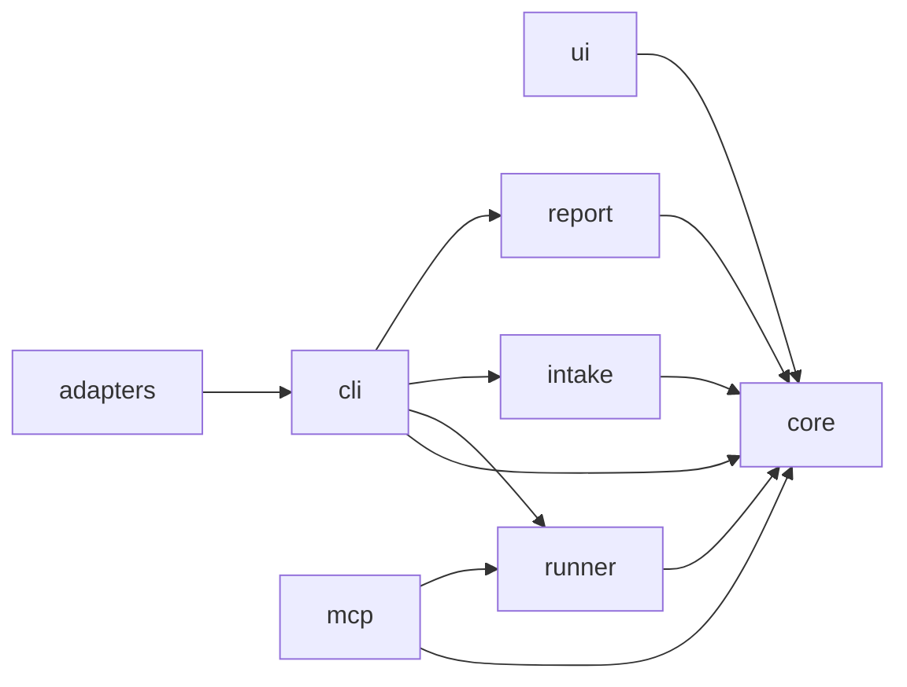

# 8. Architecture and roadmap

## Packages

A monorepo with npm workspaces. Each package has a single responsibility, and none depends on another package's interface except `core`.

```
packages/
  core/          model (schemas), reading and writing .lastro/, IDs, state machine, gate, ledger
  runner/        command execution, conditions, JUnit and SARIF parsing, evidence
  intake/        extractors per source type (docx, pdf, chat, audio, video, image), anchors, versions
  report/        item-by-item reports (md, html, pdf)
  cli/           the `lastro` command
  mcp/           MCP server (stdio)
  ui/            local dashboard (Vite + React), served by the CLI
adapters/
  claude-code/   hooks, plugin, CLAUDE.md section
  github/        action, check, PR block
  claude-ship/   REVIEW.md, approvals and classifier drafts
  git/           pre-push hook
  codex/, gemini/, cursor/
schemas/         public JSON Schema for each .lastro/ file
```



## Stack

| Piece | Choice | Reason |
|---|---|---|
| Language | Strict TypeScript, Node 22+ | Same ecosystem as MCP and the agents; distribution through npm |
| Schemas | zod, exporting JSON Schema | Runtime validation and autocomplete in the editor |
| CLI | commander | Simple and stable |
| MCP | Official MCP SDK for TypeScript | Compatible with Claude Code, Codex, Gemini CLI and Cursor |
| Index and history | SQLite (better-sqlite3) | Local, no server, can be deleted and rebuilt |
| Dashboard | Vite + React, served by the CLI on `127.0.0.1` | Lightweight, no SSR, no account |
| DOCX | mammoth (with images in order) | Keeps paragraphs and images together |
| PDF | pdfjs-dist | Text by page and block |
| Audio and video | Configurable external commands (Whisper, ffmpeg) | Lastro doesn't embed a model |
| Lastro's own tests | Vitest with JUnit, ESLint with SARIF | Lastro verifies itself |

## Architecture decisions

1. **Files in git are the truth, SQLite is a cache.** Spec review in the same PR as the code, history for free, nothing to host.
2. **No LLM inside.** Zero cost, no API key and no client data sent anywhere else. The intelligence comes from the developer's agent.
3. **Short random IDs.** No collisions between branches. The client's numbering stays in the anchor.
4. **Evidence only from its own runs.** The gate never accepts a result reported by the agent.
5. **Human commands outside MCP.** Whatever requires a person has no tool for the agent.
6. **Integrations as adapters.** The core doesn't know about Claude, GitHub or Playwright.

## Security and privacy

- No network calls in the core. The dashboard listens only on `127.0.0.1`.
- Source binaries stay out of git by default. What goes into git is configurable.
- Lastro never reads or writes secrets. Commands get the project's environment as it already is.
- Dependencies are audited in Lastro's own CI, with no open alerts.

## Languages

- Documentation in English and Brazilian Portuguese.
- CLI, dashboard and report messages in `en` and `pt-BR` from the start, chosen by `language` in `lastro.yml`.
- File keys always in English. The content stays in the requester's language.

## MVP order

The order follows value: first what ends the "what is pending?" question, then what stops the agent from pretending it's done, then what improves material intake.

1. **Format and core.**
   - Schemas, `lastro init`, reading and writing `.lastro/`, and IDs.
   - State machine with the transition conditions and the literal quote check.
   - Questions, decisions and `lastro pending`.
2. **Verification.**
   - Command runner, conditions, JUnit and SARIF parsing.
   - Flows by type, `lastro verify`, `lastro gate`, ledger and evidence that goes stale when a file changes.
   - Item-by-item report in Markdown.
3. **Claude Code.**
   - MCP server.
   - Hooks: session start with reinjection after compaction, locks on edits and on human commands, gate at the end of the response.
   - `CLAUDE.md` section and plugin.
4. **Material intake.**
   - DOCX with images in order, PDF, exported conversations.
   - Audio and video through external commands.
   - Versions and the diff between versions.
5. **Local dashboard.**
6. **External blocking and Claude Ship.**
   - `pre-push` hook, GitHub action and PR block.
   - `REVIEW.md`, approvals and classifier drafts.
7. **Ecosystem.**
   - Adapters for Codex, Gemini CLI and Cursor.
   - PDF report and JSON export for project knowledge tools.

**Pilot:** the next delivery round of a real project, measured with the metrics in [Vision and scope](02-vision-scope.md#how-success-is-measured). Lastro itself uses Lastro starting at step 2.

## Open questions

| # | Question |
|---|---|
| 1 | Relationship with Loqivo: integration through export, or does Loqivo become the hosted client portal for approval and acceptance? |
| 2 | Client acceptance in the MVP: only through a reference recorded by the dev, or also through a temporarily exposed dashboard link? |
| 3 | Does `ledger/` go into git by default, or only into the CI artifact? |
| 4 | How many consecutive blocks does the end-of-response hook allow before letting the agent stop? |
| 5 | Does the `design_contract` stage stay limited to simple rules on the diff, or does it accept an optional classifier through the agent? |
