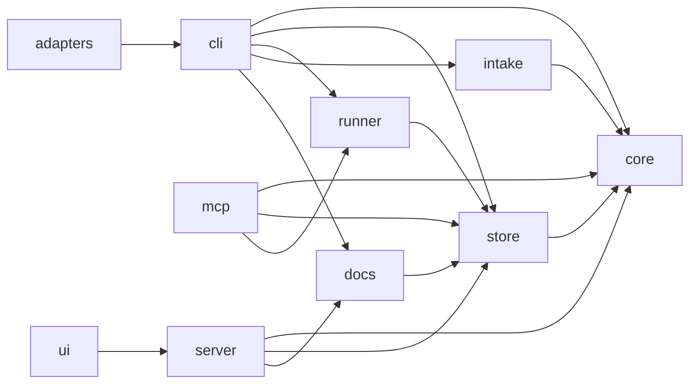

# 9. Architecture and roadmap

## Packages

A monorepo with npm workspaces. Each package has a single responsibility, and none depends on another package's interface except `core` and `store`.

```
packages/
  core/          model (schemas), reading and writing .lastro/, IDs, state machine, gate, ledger
  store/         database access with two drivers (SQLite and Postgres), migrations, sync with the files
  runner/        command execution, conditions, JUnit and SARIF parsing, evidence
  intake/        extractors per source type (docx, pdf, chat, audio, video, image), anchors, versions
  docs/          generated documentation, item-by-item reports and diagrams (md, html, pdf, mermaid, svg)
  server/        HTTP API and live events for the dashboard, login and tokens in server mode
  ui/            dashboard (Vite + React + Tailwind + shadcn/ui)
  cli/           the `lastro` command
  mcp/           MCP server (stdio)
adapters/
  claude-code/   hooks, plugin, CLAUDE.md section
  github/        action, check, PR block
  claude-ship/   REVIEW.md, approvals and classifier drafts
  git/           pre-push hook
  codex/, gemini/, cursor/
schemas/         public JSON Schema for each .lastro/ file
```



The dashboard never reads the database directly: it talks to `server`, which is the same in `lastro ui` (local) and in `lastro server` (Postgres).

## Stack

| Piece | Choice | Reason |
|---|---|---|
| Language | Strict TypeScript, Node 22+ | Same ecosystem as MCP and the agents; distribution through npm |
| Schemas | zod, exporting JSON Schema | Runtime validation and autocomplete in the editor |
| Database | SQLite (better-sqlite3) in local mode; Postgres 16+ in server mode | Zero setup on the machine; a shared database for the team |
| Database access | Kysely, with versioned migrations | One typed layer that talks to both databases, with the same schema |
| Dashboard API | Hono, with live events over SSE | Lightweight, runs on Node, the same API in both modes |
| Dashboard | Vite + React + Tailwind + shadcn/ui | No SSR, quick to serve from the CLI itself |
| Diagrams | Mermaid, rendered in the dashboard and exported as SVG | Versionable text, generated from the data |
| Charts | Recharts | Timelines and indicators |
| PDF | Playwright printing the documentation's HTML | Same look as the dashboard, with logo and colors |
| CLI | commander | Simple and stable |
| MCP | Official MCP SDK for TypeScript | Compatible with Claude Code, Codex, Gemini CLI and Cursor |
| DOCX | mammoth (with images in order) | Keeps paragraphs and images together |
| Input PDF | pdfjs-dist | Text by page and block |
| Audio and video | Configurable external commands (Whisper, ffmpeg) | Lastro doesn't embed a model |
| Lastro's own tests | Vitest with JUnit, ESLint with SARIF, Playwright on the dashboard | Lastro verifies itself |

## Architecture decisions

1. **The spec lives in git; the history lives in the database.**
   - The spec is reviewed in the same PR as the code.
   - Runs, results and metrics keep growing and need fast queries in the dashboard.
   - The database is SQLite on the machine or Postgres on the server, with the same schema.
2. **No LLM inside.** Zero cost, no API key and no client data sent anywhere else. The intelligence comes from the developer's agent.
3. **Short random IDs.** No collisions between branches. The client's numbering stays in the anchor.
4. **Evidence only from its own runs.** The gate never accepts a result reported by the agent.
5. **Human commands outside MCP.** Whatever requires a person has no tool for the agent.
6. **One dashboard, two modes.** The same `server` and the same interface serve both local mode and Postgres mode.
7. **Integrations as adapters.** The core doesn't know about Claude, GitHub or Playwright.

## Security and privacy

- **Local mode:**
  - no network calls in the core;
  - the dashboard listens only on `127.0.0.1`.
- **Server mode:**
  - the dashboard requires login;
  - CI uses a project-scoped token;
  - the database URL and the token live in environment variables, never in `lastro.yml`.
- **Sources and secrets:**
  - source binaries stay out of git by default, and what goes into git is configurable;
  - Lastro never reads or writes the project's secrets. Commands get the project's environment as it already is.
- **Dependencies:** audited in Lastro's own CI, with no open alerts.

## Languages

- Documentation in English and Brazilian Portuguese.
- CLI, dashboard and report messages in `en` and `pt-BR` from the start, chosen by `language` in `lastro.yml`.
- File keys always in English. The content stays in the requester's language.

## MVP order

The order follows value:

- first, what ends the "what is pending?" question and can already be **seen in the dashboard**;
- then, what stops the agent from pretending it's done;
- last, what improves material intake.

1. **Format, core and storage.**
   - Schemas, `lastro init`, reading and writing `.lastro/`, and IDs.
   - State machine with the transition conditions and the literal quote check.
   - Questions, decisions and `lastro pending`.
   - Database layer with SQLite and Postgres, migrations and `lastro sync`.
2. **Dashboard, first version.**
   - `lastro ui` with overview, packages, requirement, sources, questions and decisions.
   - Traceability and lifecycle diagrams.
   - `lastro docs build` with requirements, decisions, glossary and the client report.
3. **Verification.**
   - Command runner, conditions, JUnit and SARIF parsing.
   - Flows by type, `lastro verify`, `lastro gate`, ledger and evidence that goes stale when a file changes.
   - In the dashboard: test catalog, runs, the QA flow diagram with the result and quality indicators, plus the test plan and the quality report in the documentation.
4. **Claude Code.**
   - MCP server.
   - Hooks: session start with reinjection after compaction, locks on edits and on human commands, gate at the end of the response.
   - `CLAUDE.md` section and plugin.
5. **Server mode.**
   - `lastro server` with Postgres, login, tokens for CI and the projects page.
   - Artifacts in S3.
   - Dashboard events applied by `lastro sync`.
6. **Material intake.**
   - DOCX with images in order, PDF, exported conversations.
   - Audio and video through external commands.
   - Versions and the diff between versions.
7. **External blocking and Claude Ship.**
   - `pre-push` hook, GitHub action and PR block.
   - `REVIEW.md`, approvals and classifier drafts.
8. **Ecosystem.**
   - Adapters for Codex, Gemini CLI and Cursor.
   - Module map and timelines in the dashboard.
   - JSON export for project knowledge tools.

**Pilot:** the next delivery round of a real project, measured with the metrics in [Vision and scope](02-vision-scope.md#how-success-is-measured). Lastro itself uses Lastro starting at step 3.

## Open questions

| # | Question |
|---|---|
| 1 | Relationship with Loqivo: integration through export, or does Loqivo become the hosted client portal for approval and acceptance? |
| 2 | Client acceptance in the MVP: only through a reference recorded by the dev, or also through a temporarily exposed dashboard link? |
| 3 | Does `ledger/` go into git by default, or only into the CI artifact? |
| 4 | How many consecutive blocks does the end-of-response hook allow before letting the agent stop? |
| 5 | Does the `design_contract` stage stay limited to simple rules on the diff, or does it accept an optional classifier through the agent? |
| 6 | Server mode login: only email and password in the MVP, or sign in with GitHub from the start? |
