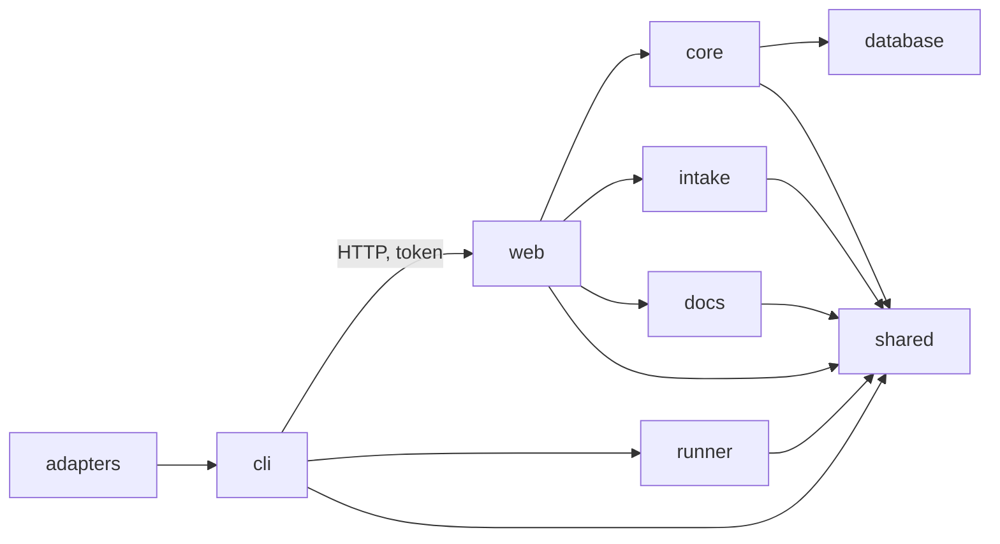

# 9. Architecture and roadmap

## Packages

A monorepo with bun workspaces and Turborepo, split into `apps/`, `packages/` and `tooling/`. Each package has a single responsibility.

```
apps/
  web/           dashboard and HTTP API (TanStack Start), /api/mcp route, sign-in
packages/
  database/      Prisma schema, versioned migrations, Postgres client, audit trigger
  shared/        zod contracts used by the API, the CLI, the MCP and the export
  core/          domain services, one folder per domain, every operation scoped by project:
                 states, gate, locks, citations, human actions, export and import
  cli/           the `lastro` command, on npm; talks to the API with a token, never to the database
  runner/        runs commands per condition, reads JUnit and SARIF, builds and uploads evidence
  intake/        source extractors: DOCX with images in order, PDF, exported conversations,
                 audio and video through external commands
  docs/          document and diagram generators: Markdown, HTML, PDF
  adapters/      Claude Code plugin (hooks, skills), git pre-push hook, GitHub Action,
                 Claude Ship templates
tooling/         shared configuration (TypeScript, ESLint)
docker/          compose.dev.yml and compose.prod.yml (web, migrate, postgres)
```



Only `core` talks to `database`, and only `web` calls `core`. The dashboard, the CLI, the MCP and CI always go through the API.

## Stack

| Piece | Choice | Reason |
|---|---|---|
| Monorepo | bun workspaces and Turborepo | Fast installs and tests, tasks cached per package |
| Language | TypeScript 6, strict | Same ecosystem as MCP and the agents. typescript-eslint does not support TypeScript 7 yet |
| Dashboard and API | TanStack Start, Router and Query | Typed routes, the API and the dashboard in the same app |
| Interface | Tailwind v4 and shadcn/ui (new-york) | Ready, accessible components, light and dark theme |
| Sign-in | better-auth (email and password, GitHub) | Sessions, workspaces and members without an external service |
| Database | Postgres 16 | One database for every project, no managed service |
| Database access | Prisma 7 (pg driver adapter, relation joins), versioned migrations, `uuid(7)` ids | A typed schema and reviewable migrations |
| Contracts | zod, exporting JSON Schema | The same validation in the API, the CLI, the MCP and the export, plus autocomplete in the editor |
| MCP | JSON-RPC route `/api/mcp` with a Bearer token; `lastro mcp` bridges stdio | A single server for every agent |
| Diagrams | Mermaid, rendered in the dashboard and exported as SVG | Versionable text, generated from the data |
| Charts | Recharts | Timelines and indicators |
| PDF | Playwright printing the documentation's HTML | Same look as the dashboard, with logo and colors |
| DOCX | mammoth (with images in order) | Keeps paragraphs and images together |
| Input PDF | pdfjs-dist | Text by page and block |
| Audio and video | Configurable external commands (Whisper, ffmpeg) | Lastro doesn't embed a model |
| Lastro's own tests | `bun test` (unit and integration against a `lastro_test` database), ESLint with SARIF, Playwright on the real screens | Lastro verifies itself |
| Distribution | Docker image and compose for a single VPS; the CLI on npm | Self-hosted, no managed services |

## Architecture decisions

1. **Postgres is the source of truth, and git receives the export.**
   - One server holds every project of a workspace, with the spec and the history together and fast queries in the dashboard.
   - `lastro export` writes a deterministic snapshot to `.lastro/`, reviewed in the same PR as the code and used by the offline CI gate. `lastro import` goes the other way.
   - There is no local mode with another database and no syncing of files with the database.
2. **A self-hosted dashboard, with sign-in.** The web app is the dashboard and the API, with workspaces, a project switcher and the project in the URL. It runs with Docker on a single VPS.
3. **Everything goes through the API.** The dashboard, the MCP and the CLI write through the same path and the same core services. The CLI never opens the database.
4. **No LLM inside.** Zero cost, no API key and no client data sent anywhere else. The intelligence comes from the developer's agent.
5. **Short random IDs.** No collisions between branches. The client's numbering stays in the anchor. In the database, the primary key is a `uuid(7)`.
6. **Evidence only from its own runs.** The gate never accepts a result reported by the agent.
7. **Human commands outside MCP and refused in the core.** Whatever requires a person has no tool for the agent, and the core service refuses the action when the actor is an agent, without relying on the hooks.
8. **Append-only audit log.** Every change produces an `AuditEvent`, and a Postgres trigger prevents updating or deleting it.
9. **Integrations as adapters.** The core doesn't know about Claude, GitHub or Playwright.
10. **TypeScript 6 across the repository.** typescript-eslint does not support TypeScript 7 yet.

## Security and privacy

- **Server:**
  - the dashboard requires sign-in (email and password, or GitHub);
  - each workspace only sees its own projects, and every core service receives the project;
  - API and MCP tokens are project-scoped and stored as SHA-256 hashes, with a visible prefix to recognize them; the value is shown only once, at creation;
  - the database URL and the token live in environment variables, never in `lastro.yml`;
  - every change produces an audit event that can't be updated or deleted.
- **CLI:**
  - talks only to the configured server, never to the database;
  - the person's token stays on the machine, outside the repository.
- **Sources and secrets:**
  - source binaries stay on the server and out of git by default, and what goes into the export is configurable;
  - Lastro never reads or writes the project's secrets. Commands get the project's environment as it already is.
- **Dependencies:** audited in Lastro's own CI (`bun audit`), with no open alerts.

## Languages

- Documentation in English and Brazilian Portuguese.
- CLI, dashboard and report messages in `en` and `pt-BR` from the start, chosen by `language` in `lastro.yml`.
- File keys always in English. The content stays in the requester's language.

## Roadmap

Lastro is being built as a complete product, not an MVP. The phases, what each one delivers, how each one is verified and their status are in the [ROADMAP](../../ROADMAP.md).

**Pilot:** the next delivery round of a real project, measured with the metrics in [Vision and scope](02-vision-scope.md#how-success-is-measured). Lastro starts tracking itself on its own server in the roadmap's dogfood phase.

## Open questions

| # | Question |
|---|---|
| 1 | Relationship with Loqivo: integration through export, or does Loqivo become the hosted client portal for approval and acceptance? |
| 2 | Client acceptance: only through a reference recorded by the dev, or also through a temporarily exposed dashboard link? |
| 3 | Does `lastro export` include the latest evidence summary per requirement, or only the spec? |
| 4 | How many consecutive blocks does the end-of-response hook allow before letting the agent stop? |
| 5 | Does the `design_contract` stage stay limited to simple rules on the diff, or does it accept an optional classifier through the agent? |
| 6 | Dashboard sign-in: email and password only, or GitHub sign-in from the start? |
