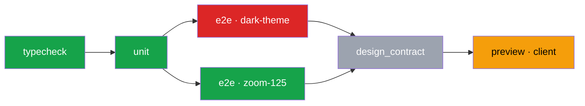
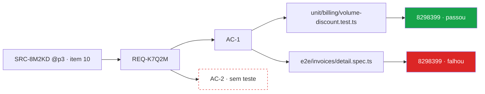

# 3. Painel, documentação e diagramas

O painel é onde tudo o que o Lastro guarda fica visível e organizado:

- o que foi pedido e de onde veio;
- o que foi testado, em quais condições e com qual resultado;
- o que falhou e por quê;
- o que falta, e de quem depende;
- a documentação do projeto, gerada a partir desses dados.

Ele é a peça central do produto. A CLI, o MCP e os hooks alimentam os dados; o painel é onde as pessoas olham, decidem e geram os documentos.

## Onde roda

O painel é a aplicação web do servidor do Lastro. A mesma aplicação serve a API HTTP que a CLI, o servidor MCP e o CI usam.

- **Auto-hospedado.** Imagem Docker e compose prontos para uma VPS só, sem serviço gerenciado. O banco é um Postgres (ver [Armazenamento](04-domain-model.md#armazenamento)).
- **Vários projetos.** Um servidor guarda todos os projetos de um workspace, e o histórico de todo mundo fica no mesmo lugar.
- **Login.** E-mail e senha, ou GitHub. Cada pessoa vê os workspaces de que é membro.
- **Seletor de projeto com busca, e o projeto na URL** (`/projects/<chave>/...`). Um link para um requisito abre sempre o mesmo projeto.
- **Tokens.** O CI e a CLI gravam pela API com um token do projeto, criado no painel.

## Organização

Tudo segue a mesma hierarquia, do mais amplo ao mais detalhado:

```
Workspace → Projeto → Pacote (rodada de entrega) → Requisito → Critério de aceite → Teste → Execução → Evidência
```

Em toda lista dá para filtrar por:

- estado e tipo;
- módulo;
- condição;
- período e commit;
- quem decidiu.

A busca global acha qualquer coisa por ID, por trecho da citação ou pelo nome do teste.

## Páginas

| Página | O que mostra |
|---|---|
| **Início** | Um cartão por projeto do workspace: cobertura, testes executados, aprovados, reprovados, gate e última execução |
| **Visão geral do projeto** | Cartões de indicadores (requisitos cobertos por testes, testes executados, aprovados, reprovados e pendentes), a barra de distribuição dos resultados, as últimas execuções, a qualidade por módulo, o funil por estado, o que segura os itens e as decisões e perguntas em aberto. "Pendente" aqui é só o que não foi verificado |
| **Requisitos** | A lista com filtros, agrupada por pacote na numeração de quem pediu. No detalhe: a citação lado a lado com o trecho da fonte, os campos, os critérios, os testes de cada critério por condição, a evidência por commit, os diagramas de rastreabilidade e de fluxo de QA, as decisões, as perguntas, o histórico de estados e as ações humanas em diálogos |
| **Testes** | O catálogo de todos os testes do projeto (detalhado abaixo) |
| **Execuções** | Lista e detalhe de cada `lastro verify` e de cada rodada do CI (detalhado abaixo) |
| **Bugs** | Os incidentes depois da entrega, com triagem, causa e cobrança (correção, cortesia ou orçamento) |
| **Agentes** | As sessões de cada agente e os eventos de cada sessão: ferramentas chamadas, arquivos tocados, bloqueios do gate |
| **Diagramas** | Os diagramas vivos do projeto, do pacote e do requisito (ver a próxima seção) |
| **Documentação** | Gerar, ler e baixar os documentos do projeto (ver mais abaixo) |
| **Fontes** | Envio dos documentos, conversas, áudios e vídeos, com as versões, a diferença entre elas, os trechos citados e os requisitos que cada trecho gerou |
| **Glossário e contrato de layout** | Os termos, as invariantes, os componentes permitidos e as telas de referência |
| **Configurações** | Editor visual dos fluxos de QA, das condições e dos comandos (incluir, tirar e reordenar etapas e condições), os membros do workspace e os tokens |
| **Auditoria** | O registro, só de inclusão, de toda mudança: quem fez, quando, por onde (painel, API, CLI ou MCP) e o que mudou |

### Página de testes

- Cada teste do projeto, identificado como `arquivo::nome do teste`, com os critérios e requisitos que ele cobre.
- O histórico de resultados por commit e por condição, com a duração de cada execução.
- **Testes instáveis:** passam e falham sem mudança no código que eles cobrem.
- **Testes órfãos:** existem no projeto, mas não cobrem nenhum critério.
- **Critérios sem teste:** a lista do que ainda não tem como ser verificado.

### Página de execuções

Cada execução mostra:

- quem disparou (dev, agente ou CI), o commit e a branch;
- as etapas e as condições, em ordem, com o resultado de cada uma;
- o comando rodado, a saída, a duração e o código de saída;
- os prints, vídeos e relatórios anexados;
- a comparação com a execução anterior do mesmo requisito: o que passou a falhar e o que voltou a passar.

## Diagramas vivos

Os diagramas são gerados a partir dos dados, nunca desenhados à mão, então nunca ficam desatualizados.

- São escritos em Mermaid e renderizados no painel.
- Clicar num elemento abre o item.
- Os mesmos diagramas vão para a documentação gerada, como Mermaid e SVG.

### Fluxo de QA de um requisito, com o resultado

Cada etapa, em cada condição, colorida pelo último resultado no commit atual:



Verde passou, vermelho falhou, cinza não rodou porque uma etapa anterior falhou, e laranja aguarda uma pessoa.

### Rastreabilidade

Da fonte até a evidência, com os buracos destacados:



O que aparece como buraco:

- critério sem teste;
- teste sem execução no commit atual;
- citação que não confere com a fonte;
- requisito sem fonte final.

### Ciclo de vida do pacote

O diagrama de estados do [ciclo de vida](05-lifecycle-and-gates.md), com a quantidade de itens em cada estado e as passagens que estão travadas.

### Mapa de módulos

Os módulos do sistema, com quantos requisitos e incidentes cada um tem. Sai do `reach.modules` e dos arquivos em `touches`. Mostra onde o projeto mais quebra.

### Linhas do tempo

Gráficos, não diagramas:

- resultados por commit e por dia;
- incidentes por pacote, separados por causa (spec incompleta, implementação, regressão);
- itens reabertos por pacote.

## Documentação gerada

`lastro docs build` gera a documentação a partir dos dados, nunca da memória do agente. O painel tem o mesmo botão.

| Documento | Conteúdo |
|---|---|
| **Visão do projeto** | Pacotes, módulos, glossário e números gerais |
| **Requisitos** | Por módulo: origem, regra, campos, critérios e estado |
| **Regras de negócio e invariantes** | O glossário e as invariantes, com os testes que as protegem |
| **Decisões** | Todas as decisões, com o motivo e quem decidiu |
| **Plano de testes** | Os fluxos de QA por tipo, as condições e os comandos |
| **Casos de teste** | O catálogo, com o que cada teste cobre |
| **Relatório de qualidade** | Indicadores, testes executados, falhas e pendências, por pacote ou por período |
| **Histórico de entregas** | Por pacote: o que entrou, com a evidência |
| **Relatório do cliente** | Item a item, na numeração de quem pediu (ver [Pacotes e o relatório item a item](05-lifecycle-and-gates.md#pacotes-e-o-relatório-item-a-item)) |
| **Diagramas** | Os diagramas vivos acima, em Mermaid e SVG |

- Formatos: Markdown, HTML e PDF.
- O PDF aceita logo, cores e capa do desenvolvedor.
- Os arquivos em Markdown podem ir para o repositório, em `docs/lastro/`, se o projeto configurar.
- Todo documento diz de qual commit e de qual data foi gerado. Gerado de novo no CI, ele acompanha o código.

## Ações humanas no painel

Pelo painel, uma pessoa pode:

- aprovar spec;
- confirmar ou derrubar decisão;
- destravar critério;
- tirar um item do escopo;
- responder pergunta;
- registrar prévia e etapa manual;
- aceitar entrega;
- fazer a triagem de incidente;
- marcar uma fonte como final;
- editar os fluxos de QA.

São as mesmas ações humanas da CLI, e o agente não tem acesso a nenhuma delas.

- Toda ação é uma escrita na API do servidor e gera um evento de auditoria.
- O núcleo recusa a ação quando quem pede é um agente, qualquer que seja a porta de entrada.
- A mudança chega ao repositório no próximo `lastro export`, para a spec continuar revisada no PR.

## Visual

- TanStack Start, Router e Query, com Tailwind v4 e shadcn/ui (estilo new-york).
- Denso e voltado para os dados: cartões de indicadores, tabelas e gráficos antes de texto.
- Tema claro e escuro.
- Funciona em tela de notebook e de celular.
- Confirmações por diálogo próprio, nunca pelas caixas nativas do navegador.
- Diagramas em Mermaid; gráficos em Recharts.
