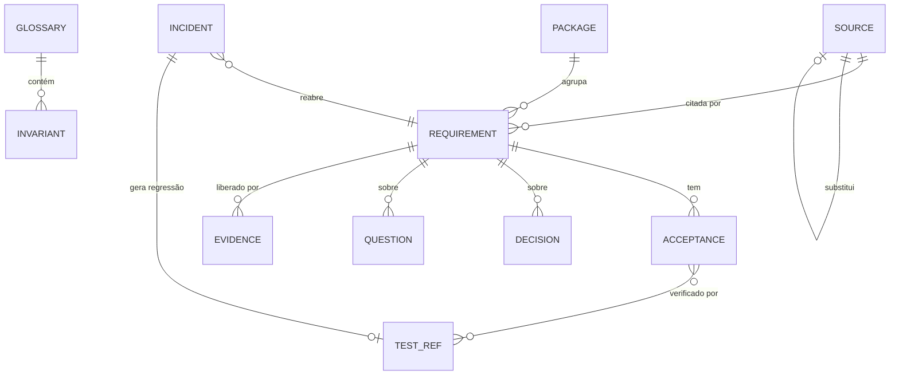

# 3. Modelo de dados e formato dos arquivos

## Onde tudo fica

```
.lastro/
  lastro.yml            configuração: tipos, campos obrigatórios, fluxos de QA, condições, gate
  glossary.yml          termos do domínio e invariantes
  design.yml            contrato de layout
  sources/              uma fonte por arquivo (metadados + texto extraído com âncoras)
  requirements/         um requisito por arquivo
  decisions/            suposições e decisões
  questions/            perguntas em aberto e respondidas
  incidents/            reclamações e defeitos depois da entrega
  packages/             rodadas de entrega (ex.: "Correções v.4")
  ledger/               a última evidência que liberou cada requisito (pequena, versionada)
  .store/               binários das fontes e artefatos (fora do git por padrão)
  .state/               índice SQLite e histórico completo de execuções (fora do git)
  .out/                 saídas temporárias dos comandos (fora do git)
```

- O que está em YAML e Markdown é a verdade e vai no git, revisado no mesmo PR que o código.
- O SQLite é só índice e histórico. Pode ser apagado e reconstruído.
- O `lastro.yml` tem `version: 1` no topo, e todo arquivo de `.lastro/` é validado por um JSON Schema publicado, para os editores avisarem erro de digitação.

## IDs

- Formato `<PREFIXO>-<5 caracteres base32>`, por exemplo `REQ-K7Q2M`, `DEC-3F9TA`. Aleatório para não colidir quando dois branches criam itens ao mesmo tempo.
- A numeração do cliente ("item 14 do documento") não vira ID: fica na âncora da fonte e aparece no relatório.
- Prefixos: `SRC` fonte, `REQ` requisito, `AC` critério (local ao requisito), `DEC` decisão, `Q` pergunta, `INC` incidente, `PKG` pacote, `ART` artefato, `INV` invariante.

## Entidades



### Fonte (`sources/SRC-xxxxx.yml`)

Tudo o que chega de quem pede: documento, conversa, áudio, vídeo, print, reunião.

```yaml
id: SRC-8M2KD
kind: docx            # docx | pdf | chat | audio | video | image | meeting | text
title: "Correções v.4.docx"
from: client          # client | dev | team
received_at: 2026-11-14T15:17:00-03:00
hash: sha256:9f1c...  # do arquivo original, guardado em .store/
version: 2
supersedes: SRC-4TQ7B # versão anterior com o mesmo nome
final: true           # só fontes finais podem sustentar requisito aprovado (configurável)
extracted: SRC-8M2KD.md   # texto extraído com âncoras, ao lado deste arquivo
machine_transcript: false # true para áudio e vídeo transcritos: a citação pede confirmação
```

Para uma fonte que já está no repositório (um PRD, uma spec em Markdown), `path` aponta para o arquivo ou a pasta no lugar de `extracted`, e as âncoras usam o arquivo e o título da seção.

O texto extraído (`SRC-8M2KD.md`) marca as âncoras assim:

```markdown
<!-- @p3 -->
10. Faturas: o desconto por volume tem que sair na fatura, inclusive no plano anual. Hoje só aparece no mensal.
<!-- @p3/img2 -->

```

Âncoras por tipo:

| Tipo | Âncora |
|---|---|
| docx | parágrafo e imagem na ordem do documento (`@p3`, `@p3/img2`) |
| pdf | página e bloco (`@pg12/b4`) |
| chat | id da mensagem (`@msg:3A5B...`), com autor e horário |
| audio, video | minuto e segundo (`@t00:34`); no vídeo também o quadro extraído |
| image | a imagem inteira (`@img`) |
| text (arquivo do próprio repositório) | arquivo e título da seção (`@04-lifecycle-and-gates.md#estados-de-um-requisito`) |

### Requisito (`requirements/REQ-xxxxx.yml`)

A unidade de trabalho. Atômico: um comportamento verificável.

```yaml
id: REQ-K7Q2M
title: "Desconto por volume aparece na fatura do plano anual"
type: calculation     # tipos definidos no lastro.yml
status: specified     # ver o ciclo de vida
package: PKG-2R8XW
sources:
  - ref: SRC-8M2KD
    anchor: "@p3"
    label: "item 10"   # numeração de quem pediu
    quote: "o desconto por volume tem que sair na fatura, inclusive no plano anual"
statement: >
  A fatura mostra uma linha "Desconto por volume" com o percentual e o valor
  descontado, em planos mensais e anuais, sempre que a conta passar da faixa mínima.
where: "Financeiro › Faturas › detalhe da fatura (tela e PDF)"
who:
  sees: [owner, billing_admin]
  uses: [billing_admin]
  scope: account       # escopo de dados: own | team | account | all
data_source: "tabela de faixas de desconto vigente na data de emissão"
period: "ciclo de cobrança da fatura"
reach:
  modules: [invoices, invoice_pdf, billing_email]
  tenants: all         # all | lista
visual_ref: [ART-5HQ2C]
when_missing: "sem faixa atingida, a linha não aparece; nunca mostra desconto zero"
examples:
  - given: "plano anual de R$ 12.000, 60 licenças, faixa de 50+ licenças = 8%"
    expect: "linha 'Desconto por volume 8%' de R$ 960,00 e total de R$ 11.040,00"
acceptance:
  - id: AC-1
    text: >
      Dado um plano anual de R$ 12.000 com 60 licenças e a faixa de 8% a partir de 50,
      quando a fatura é emitida,
      então a tela e o PDF mostram "Desconto por volume 8%" de R$ 960,00 e total de R$ 11.040,00.
    tests: ["unit/billing/volume-discount.test.ts::annual plan 60 seats",
            "e2e/invoices/detail.spec.ts::discount line"]
    locked: sha256:41aa...   # preenchido pelo `lastro lock`
decisions: [DEC-3F9TA]
questions: []
depends_on: []
touches: []            # arquivos alterados, preenchido pelo Lastro a partir do git
```

Campos que todo requisito tem: `id`, `title`, `type`, `status`, `sources` (com `quote`), `statement`, `acceptance`.

Os demais campos são **obrigatórios por tipo**, conforme o `lastro.yml`. Exemplos de partida:

| Tipo | Obrigatórios além do básico |
|---|---|
| `visual` | `where`, `visual_ref`, `who` |
| `calculation` | `data_source`, `period`, `examples`, `reach`, `when_missing` |
| `permission` | `who`, `reach` |
| `import` | `data_source`, `examples`, `when_missing` |
| `integration` | `data_source`, `when_missing` |
| `behavior` | `where`, `who` |

### Critério de aceite (dentro do requisito)

- Escrito no formato **Dado / quando / então**, ou no formato de quem pediu ("como está, como deve ficar, como conferir").
- Usa os exemplos e números de quem pediu sempre que existirem.
- Aponta para um ou mais testes (`tests`) ou para uma etapa manual do fluxo.
- `lastro lock` grava o hash do texto do critério e dos testes ligados. A partir daí, mudar critério ou teste exige um comando humano (ver [Como obrigar o agente a seguir](05-enforcement.md)).

### Decisão (`decisions/DEC-xxxxx.yml`)

```yaml
id: DEC-3F9TA
about: [REQ-K7Q2M]
kind: assumption       # assumption | decision | client_answer
text: "O pedido não diz se o desconto aparece no e-mail de cobrança. Adotado: aparece, igual à tela e ao PDF."
reason: "O e-mail repete o resumo da fatura; um total diferente do PDF geraria dúvida no cliente final."
decided_by: agent      # agent | dev | client
status: proposed       # proposed | confirmed | overturned
show_to_client: true   # aparece no relatório como "decidimos"
source: null           # para client_answer: a mensagem ou documento com a resposta
```

- Suposição do agente nasce `proposed` e não trava o item.
- O desenvolvedor confirma ou derruba. Derrubada reabre o requisito.
- No relatório do cliente, a decisão aparece como afirmação: "Decidimos mostrar o desconto também no e-mail de cobrança, porque o pedido não dizia e o e-mail repete a fatura".

### Pergunta (`questions/Q-xxxxx.yml`)

```yaml
id: Q-7WD2P
about: [REQ-K7Q2M]
text: "Se a conta cai abaixo da faixa no meio do ciclo, o desconto vale até o fim do ciclo ou é recalculado?"
blocks: true           # trava o requisito antes de 'approved'
asked_to: client
asked_via: "whatsapp"
asked_at: 2026-11-16T10:02:00-03:00
answer: null
answer_source: null    # ex.: SRC-9Q3LM @msg:3EB0...
```

- Pergunta com `blocks: true` trava só o requisito dela, não o pacote.
- Respondida, a resposta vira uma decisão `client_answer` com a fonte.

### Incidente (`incidents/INC-xxxxx.yml`)

Toda reclamação depois da entrega.

```yaml
id: INC-2B8KV
reported: "Por que o desconto não saiu no PDF da fatura anual?"
source: { ref: SRC-6TT9A, anchor: "@msg:3A9F..." }
triage: bug            # bug | config | missing_data | usage | improvement | not_a_defect
cause: spec_gap        # spec_gap | implementation | regression | client_change | environment
requirement: REQ-K7Q2M
regression_test: "e2e/invoices/pdf.spec.ts::discount on annual plan"
billing: fix           # fix | courtesy | quote
```

- `triage` responde se é defeito de verdade.
- `cause` responde "erramos ou o escopo estava incompleto?".
- `billing` responde se é correção, cortesia ou vai para orçamento.
- Incidente com `triage: bug` exige `regression_test` antes de o requisito voltar a `verified`.

### Pacote (`packages/PKG-xxxxx.yml`)

Uma rodada de entrega: um documento de correções, um lote de mensagens, uma versão.

```yaml
id: PKG-2R8XW
title: "Correções v.4"
sources: [SRC-8M2KD]
opened_at: 2026-11-14
closed_at: null
report: true           # gera relatório item a item para o cliente
```

### Glossário e invariantes (`glossary.yml`)

```yaml
terms:
  - term: "Gerente"
    means: "o papel Manager do sistema"
    note: "quem pede fala 'gerente'; no código e no banco o papel se chama manager"
  - term: "cliente ativo"
    means: "conta com pagamento confirmado nos últimos 30 dias"
invariants:
  - id: INV-1
    text: "Todo cadastro de pessoa com acesso cria uma conta de login real."
    tests: ["e2e/users/real-account.spec.ts"]
  - id: INV-2
    text: "Regra de negócio e permissão são calculadas na API; o front só exibe."
```

Invariante com `tests` entra no gate de todo requisito que toca os mesmos arquivos.

### Contrato de layout (`design.yml`)

```yaml
components:
  modal: "app-modal"
  tabs: "app-tabs"
  kpi: "app-kpi"
  filter_bar: "app-filter-bar"
forbidden:
  - "janela, cartão ou cor fora destes componentes"
  - "dois estilos de filtro na mesma aplicação"
palette:
  primary: "#1F6FEB"
  accent: "#F59E0B"
reference_screens: [ART-1KQ8D, ART-7PM3X]
```

O contrato vai para o contexto do agente, gera a seção de layout do `REVIEW.md` e pode ser conferido por um check do fluxo `visual`.

### Evidência (`ledger/REQ-xxxxx.json` e `.state/`)

Cada execução feita pelo Lastro grava:

```json
{
  "requirement": "REQ-K7Q2M",
  "stage": "e2e",
  "condition": "member-profile",
  "commit": "8298399",
  "tree": "sha1 da árvore dos arquivos em 'touches'",
  "command": "npx playwright test e2e/invoices --reporter=junit",
  "exit_code": 0,
  "started_at": "2026-11-25T14:02:11Z",
  "duration_ms": 41210,
  "results": { "passed": 6, "failed": 0, "skipped": 0 },
  "artifacts": ["ART-9XQ1T"],
  "by": "lastro"
}
```

- O histórico completo fica no SQLite.
- O `ledger/` guarda só a evidência que liberou cada requisito na entrega, para o PR e o relatório.
- Artefatos (prints, vídeos, saídas longas) ficam em `.store/` por hash. Podem ir para o git ou para o LFS se o projeto configurar.

## O que é sensível

Material de cliente costuma ter dado pessoal. Por padrão:

- o binário da fonte fica em `.store/`, fora do git;
- o texto extraído vai no git (configurável: `sources.commit: text | none | all`);
- o Lastro nunca manda nada para fora da máquina. Quem envia material a um LLM é o agente, pelas regras dele.
