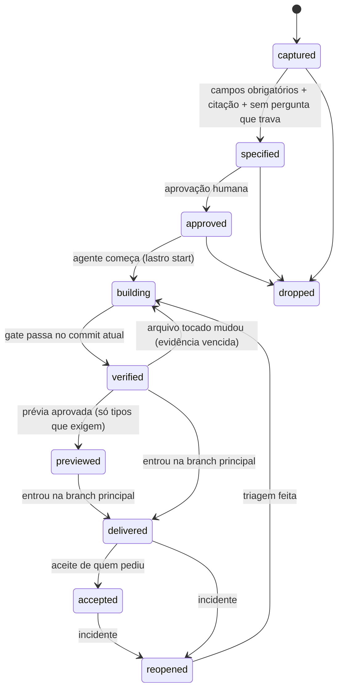

# 5. Ciclo de vida, gate e fluxos de QA

## Estados de um requisito



| Estado | Significa | Quem move |
|---|---|---|
| `captured` | Item extraído da fonte, ainda incompleto | Agente ou pessoa |
| `specified` | Campos obrigatórios do tipo preenchidos, citação ancorada, nenhuma pergunta que trava em aberto | Lastro, quando as condições batem |
| `approved` | Spec aceita para implementação | Pessoa (dev, cliente ou os dois, conforme o `lastro.yml`) |
| `building` | Em implementação, com branch registrada | Agente |
| `verified` | Gate verde no commit atual | Lastro |
| `previewed` | Prévia visual aprovada por quem tem que aprovar | Pessoa, com a referência da aprovação |
| `delivered` | O commit verificado está na branch principal (ou na tag de release) | Lastro, lendo o git |
| `accepted` | Quem pediu aceitou | Pessoa, com a referência do aceite |
| `reopened` | Um incidente voltou a abrir o item | Lastro, ao registrar o incidente |
| `dropped` | Saiu do escopo, com motivo | Pessoa |

**Pendente é só o que não chegou em `verified`.** O painel e o comando `lastro pending` nunca listam item verificado como pendência, nem "falta subir para produção".

## O que libera cada passagem

### `captured` → `specified`

- Todos os campos obrigatórios do tipo estão preenchidos.
- Toda `quote` existe literalmente no texto extraído da fonte, na âncora indicada. O Lastro confere. Citação inventada é recusada.
- Nenhuma pergunta com `blocks: true` está aberta.
- Se a fonte é `machine_transcript: true`, a citação foi confirmada por uma pessoa.

### `specified` → `approved`

- Comando humano: `lastro approve REQ-K7Q2M` ou o pacote inteiro (`lastro approve PKG-2R8XW`).
- Se o `lastro.yml` exige fonte final (`approval.require_final_source`), todas as fontes citadas têm `final: true`. Dá para especificar a partir de um rascunho, mas só se aprova a partir da versão final.
- O agente não tem esse comando (ver [Como obrigar o agente a seguir](06-enforcement.md)).
- Aprovar trava os critérios de aceite (`lastro lock` automático).

### `building` → `verified` (o gate)

O gate de um requisito passa quando, **no commit atual**:

1. Cada critério de aceite tem pelo menos um teste ligado, e todos os testes ligados passaram numa execução feita pelo Lastro.
2. Cada etapa do fluxo de QA do tipo passou, em cada condição que a etapa exige.
3. Os comandos globais do projeto passaram (typecheck, lint, testes unitários), conforme o `lastro.yml`.
4. Nenhum critério ou teste travado mudou desde o `lock`.
5. Os testes de regressão de incidentes ligados ao requisito passaram.
6. As invariantes com testes que tocam os mesmos arquivos passaram.
7. Nenhuma decisão ligada está `overturned`.

A evidência vale para a árvore dos arquivos em `touches`. Se qualquer um deles mudar depois, o requisito volta a `building` com o motivo "evidência vencida".

### `verified` → `previewed`

- Só para os tipos cujo fluxo tem a etapa `preview` (por padrão, `visual`).
- O Lastro gera o artefato (print das telas e condições exigidas) e o desenvolvedor registra quem aprovou e onde: `lastro check REQ-K7Q2M preview --pass --by client --ref "whatsapp @msg:3EB0..."`.

### `delivered` → `accepted`

- Aceite explícito, com referência.
- Ou aceite tácito depois de N dias sem incidente, se o projeto configurar (`acceptance.tacit_after_days`).

## Fluxos de QA configuráveis

O fluxo de QA de cada tipo de requisito fica no `lastro.yml`. Ele pode ser editado à mão, pela CLI (`lastro flow ...`) ou pelo painel.

```yaml
version: 1
project: "my-app"
language: pt-BR

approval:
  spec: [dev]              # papéis que aprovam a spec: dev, client ou os dois
  require_final_source: true

commands:                  # comandos do próprio projeto; o Lastro executa e lê o resultado
  typecheck: { run: "npm run typecheck" }
  lint:      { run: "npx eslint . -f @microsoft/eslint-formatter-sarif -o .lastro/.out/eslint.sarif", report: { sarif: ".lastro/.out/eslint.sarif" } }
  unit:      { run: "npx vitest run --reporter=junit --outputFile=.lastro/.out/unit.xml", report: { junit: ".lastro/.out/unit.xml" } }
  e2e:       { run: "npx playwright test --reporter=junit", env: { PLAYWRIGHT_JUNIT_OUTPUT_NAME: ".lastro/.out/e2e.xml" }, report: { junit: ".lastro/.out/e2e.xml" } }

conditions:                # condições de uso reais, reaproveitadas pelos fluxos
  member-profile:       { env: { E2E_PROFILE: "member" }, note: "usuário comum, sem papel de gestão" }
  multi-tenant:         { env: { E2E_PROFILE: "member-2-tenants" }, note: "pessoa com acesso a duas contas" }
  real-volume:          { setup: "npm run db:seed:volume", note: "base anonimizada no tamanho da produção" }
  dark-theme:           { env: { E2E_THEME: "dark" } }
  zoom-125:             { env: { E2E_ZOOM: "1.25" } }
  empty-tenant:         { setup: "npm run db:seed:empty-tenant", note: "conta nova, sem nada configurado" }

types:
  calculation:
    required: [data_source, period, examples, reach, when_missing]
    flow:
      - typecheck
      - unit
      - { check: examples, note: "cada exemplo numérico vira teste e passa" }
      - { check: source_reconciliation, manual: true, by: dev, note: "um caso real conferido contra a fonte original (planilha, BI, documento)" }
  permission:
    required: [who, reach]
    flow:
      - unit
      - { run: e2e, conditions: [member-profile, multi-tenant] }
  visual:
    required: [where, visual_ref, who]
    flow:
      - typecheck
      - { run: e2e, conditions: [dark-theme, zoom-125] }
      - { check: design_contract }
      - { check: preview, manual: true, by: client }
  import:
    required: [data_source, examples, when_missing]
    flow:
      - unit
      - { run: e2e, conditions: [real-volume, empty-tenant] }
  behavior:
    required: [where, who]
    flow: [typecheck, unit, e2e]

global_flow: [typecheck, lint]   # roda no gate de qualquer requisito

gate:
  block_agent_stop: true         # hook de fim de resposta no Claude Code
  stale_on_change: true          # evidência vence quando um arquivo tocado muda
  ci: required                   # o check do CI é obrigatório na branch principal

acceptance:
  tacit_after_days: null
```

### Tipos de etapa

| Etapa | O que faz |
|---|---|
| `<comando>` | Roda um comando de `commands`. Passa com código de saída 0 e, se houver relatório JUnit ou SARIF, sem falha nos testes ligados ou sem erro acima do limite |
| `{ run: <comando>, conditions: [...] }` | Roda o comando uma vez por condição, com o `env` e o `setup` dela. A evidência fica separada por condição |
| `{ check: examples }` | Confere que cada item de `examples` tem um teste ligado e que ele passou |
| `{ check: design_contract }` | Procura no diff o que o `design.yml` proíbe (classes, cores, componentes fora da lista). Regras simples, sem LLM |
| `{ check: <nome>, manual: true, by: <papel> }` | Etapa assinada por uma pessoa, com referência. O agente não consegue marcar |
| `{ check: preview, manual: true, by: client }` | Gera os prints da etapa e espera a aprovação registrada |

### Comandos da CLI para os fluxos

```bash
lastro flow list
lastro flow show calculation
lastro flow add-stage visual --check preview --manual --by client
lastro condition add zoom-150 --env E2E_ZOOM=1.5
```

## Pacotes e o relatório item a item

Um pacote fecha quando todos os itens estão em `verified` ou além, ou em `dropped` com motivo. O relatório do pacote (`lastro report PKG-2R8XW`) traz, para cada item, na ordem e na numeração de quem pediu:

| Coluna | Conteúdo |
|---|---|
| Pedido | O texto literal da fonte, com a âncora |
| Situação | Estado atual, em linguagem de cliente |
| O que foi feito | O `statement` e o resumo das mudanças |
| Decidimos | As decisões com `show_to_client: true`, como afirmação |
| Onde ver | O campo `where` |
| Evidência | Link para os prints e os resultados da entrega |

Perguntas ainda abertas não aparecem como item feito com ressalva: o item continua fora do relatório de entregues e entra na lista de "aguardando resposta".
