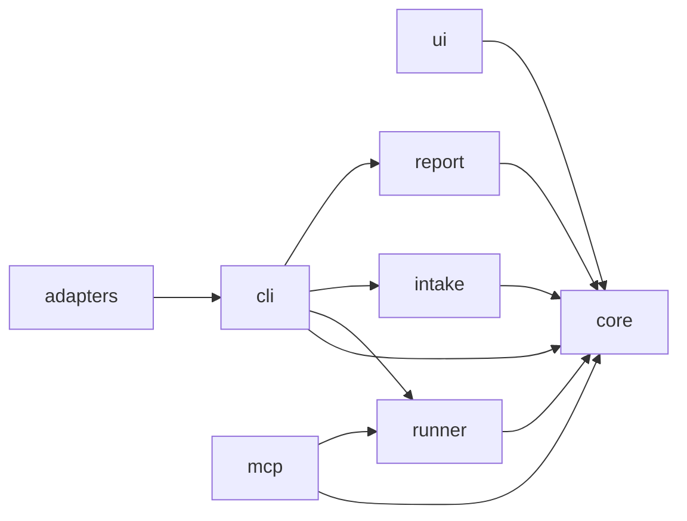

# 8. Arquitetura e roteiro

## Pacotes

Monorepo com workspaces do npm. Cada pacote tem uma responsabilidade só, e nenhum depende da interface de outro além do `core`.

```
packages/
  core/          modelo (schemas), leitura e escrita de .lastro/, IDs, máquina de estados, gate, ledger
  runner/        execução de comandos, condições, leitura de JUnit e SARIF, evidência
  intake/        extratores por tipo de fonte (docx, pdf, chat, audio, video, image), âncoras, versões
  report/        relatórios item a item (md, html, pdf)
  cli/           o comando `lastro`
  mcp/           servidor MCP (stdio)
  ui/            painel local (Vite + React), servido pela CLI
adapters/
  claude-code/   hooks, plugin, seção do CLAUDE.md
  github/        action, check, bloco do PR
  claude-ship/   REVIEW.md, esboços de approvals e classificador
  git/           hook pre-push
  codex/, gemini/, cursor/
schemas/         JSON Schema público de cada arquivo de .lastro/
```



## Stack

| Peça | Escolha | Motivo |
|---|---|---|
| Linguagem | TypeScript estrito, Node 22+ | Mesmo ecossistema do MCP e dos agentes; distribuição por npm |
| Schemas | zod, exportando JSON Schema | Validação em runtime e autocompletar no editor |
| CLI | commander | Simples e estável |
| MCP | SDK oficial de MCP para TypeScript | Compatível com Claude Code, Codex, Gemini CLI e Cursor |
| Índice e histórico | SQLite (better-sqlite3) | Local, sem servidor, apagável e reconstruível |
| Painel | Vite + React, servido pela CLI em `127.0.0.1` | Leve, sem SSR, sem conta |
| DOCX | mammoth (com as imagens na ordem) | Mantém parágrafo e imagem juntos |
| PDF | pdfjs-dist | Texto por página e bloco |
| Áudio e vídeo | comandos externos configuráveis (Whisper, ffmpeg) | O Lastro não embute modelo |
| Testes do próprio Lastro | Vitest com JUnit, ESLint com SARIF | O Lastro verifica a si mesmo |

## Decisões de arquitetura

1. **Arquivos no git são a verdade, o SQLite é cache.** Revisão da spec no mesmo PR do código, histórico de graça, nada para hospedar.
2. **Sem LLM dentro.** Custo zero, sem chave de API e sem mandar dado de cliente para outro lugar. A inteligência vem do agente do desenvolvedor.
3. **IDs aleatórios curtos.** Sem colisão entre branches. A numeração do cliente fica na âncora.
4. **Evidência só de execução própria.** O gate nunca aceita resultado relatado pelo agente.
5. **Comandos humanos fora do MCP.** O que exige pessoa não tem ferramenta para o agente.
6. **Integrações como adaptadores.** O núcleo não conhece Claude, GitHub nem Playwright.

## Segurança e privacidade

- Nenhuma chamada de rede no núcleo. O painel escuta só em `127.0.0.1`.
- Binários de fonte fora do git por padrão. O que vai para o git é configurável.
- O Lastro nunca lê nem grava segredo. Comandos recebem o ambiente do projeto como ele já é.
- Dependências auditadas no CI do próprio Lastro, sem alerta aberto.

## Idiomas

- Documentação em inglês e português do Brasil.
- Mensagens da CLI, do painel e dos relatórios em `en` e `pt-BR` desde o começo, escolhidos por `language` no `lastro.yml`.
- Chaves dos arquivos sempre em inglês. O conteúdo fica no idioma de quem pede.

## Ordem do MVP

A ordem segue o valor: primeiro o que acaba com o "o que está pendente?", depois o que impede o agente de fingir que terminou, depois o que melhora a entrada de material.

1. **Formato e núcleo.**
   - Schemas, `lastro init`, leitura e escrita de `.lastro/` e IDs.
   - Máquina de estados com as condições de passagem e conferência de citação literal.
   - Perguntas, decisões e `lastro pending`.
2. **Verificação.**
   - Executor de comandos, condições, leitura de JUnit e SARIF.
   - Fluxos por tipo, `lastro verify`, `lastro gate`, ledger e evidência vencida por mudança de arquivo.
   - Relatório item a item em Markdown.
3. **Claude Code.**
   - Servidor MCP.
   - Hooks: início de sessão com reinjeção depois de compactação, travas de edição e de comando humano, gate no fim de resposta.
   - Seção do `CLAUDE.md` e plugin.
4. **Entrada de material.**
   - DOCX com imagens na ordem, PDF, conversa exportada.
   - Áudio e vídeo por comandos externos.
   - Versões e diferença entre versões.
5. **Painel local.**
6. **Bloqueio externo e Claude Ship.**
   - Hook `pre-push`, action do GitHub e bloco no PR.
   - `REVIEW.md`, esboços de approvals e classificador.
7. **Ecossistema.**
   - Adaptadores para Codex, Gemini CLI e Cursor.
   - Relatório em PDF e exportação JSON para ferramentas de conhecimento de projeto.

**Piloto:** a próxima rodada de entrega de um projeto real, medida com as métricas de [Visão e escopo](02-vision-scope.md#como-se-mede-o-sucesso). O próprio Lastro usa o Lastro a partir da etapa 2.

## Perguntas em aberto

| # | Pergunta |
|---|---|
| 1 | Relação com a Loqivo: integração por exportação, ou a Loqivo vira o portal hospedado do cliente para aprovação e aceite? |
| 2 | Aceite do cliente no MVP: só por referência registrada pelo dev, ou também por um link do painel exposto temporariamente? |
| 3 | O `ledger/` vai no git por padrão, ou só no artefato do CI? |
| 4 | Quantos bloqueios seguidos o hook de fim de resposta permite antes de liberar? |
| 5 | A etapa `design_contract` fica só em regras simples sobre o diff, ou aceita um classificador opcional via agente? |
