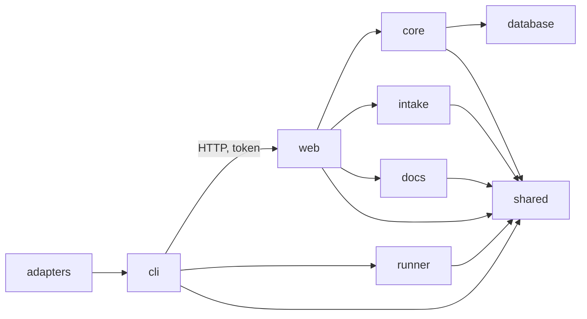

# 9. Arquitetura e roteiro

## Pacotes

Monorepo com workspaces do bun e Turborepo, dividido em `apps/`, `packages/` e `tooling/`. Cada pacote tem uma responsabilidade só.

```
apps/
  web/           painel e API HTTP (TanStack Start), rota /api/mcp, login
packages/
  database/      esquema Prisma, migrações versionadas, cliente do Postgres, trigger da auditoria
  shared/        contratos zod usados pela API, pela CLI, pelo MCP e pela exportação
  core/          serviços de domínio, uma pasta por domínio, toda operação com o projeto:
                 estados, gate, travas, citações, ações humanas, exportação e importação
  cli/           o comando `lastro`, no npm; fala com a API por token, nunca com o banco
  runner/        execução dos comandos por condição, leitura de JUnit e SARIF, montagem e envio da evidência
  intake/        extratores de fonte: DOCX com imagens na ordem, PDF, conversas exportadas,
                 áudio e vídeo por comandos externos
  docs/          geradores de documentos e diagramas: Markdown, HTML, PDF
  adapters/      plugin do Claude Code (hooks, skills), hook pre-push do git, action do GitHub,
                 modelos do Claude Ship
tooling/         configurações compartilhadas (TypeScript, ESLint)
docker/          compose.dev.yml e compose.prod.yml (web, migrate, postgres)
```



Só o `core` fala com o `database`, e só o `web` chama o `core`. O painel, a CLI, o MCP e o CI passam sempre pela API.

## Stack

| Peça | Escolha | Motivo |
|---|---|---|
| Monorepo | Workspaces do bun e Turborepo | Instalação e testes rápidos, tarefas em cache por pacote |
| Linguagem | TypeScript 6, estrito | Mesmo ecossistema do MCP e dos agentes. O typescript-eslint ainda não suporta o TypeScript 7 |
| Painel e API | TanStack Start, Router e Query | Rotas tipadas, a API e o painel na mesma aplicação |
| Interface | Tailwind v4 e shadcn/ui (new-york) | Componentes prontos e acessíveis, tema claro e escuro |
| Login | better-auth (e-mail e senha, GitHub) | Sessões, workspaces e membros sem serviço externo |
| Banco | Postgres 16 | Um banco para todos os projetos, sem serviço gerenciado |
| Acesso ao banco | Prisma 7 (adaptador pg, relation joins), migrações versionadas, ids `uuid(7)` | Esquema tipado e migrações revisáveis |
| Contratos | zod, exportando JSON Schema | A mesma validação na API, na CLI, no MCP e na exportação, e autocompletar no editor |
| MCP | Rota JSON-RPC `/api/mcp` com token Bearer; `lastro mcp` faz a ponte stdio | Um servidor só para todos os agentes |
| Diagramas | Mermaid, renderizado no painel e exportado em SVG | Texto versionável, gerado a partir dos dados |
| Gráficos | Recharts | Linhas do tempo e indicadores |
| PDF | Playwright imprimindo o HTML da documentação | Mesmo visual do painel, com logo e cores |
| DOCX | mammoth (com as imagens na ordem) | Mantém parágrafo e imagem juntos |
| PDF de entrada | pdfjs-dist | Texto por página e bloco |
| Áudio e vídeo | comandos externos configuráveis (Whisper, ffmpeg) | O Lastro não embute modelo |
| Testes do próprio Lastro | `bun test` (unidade e integração contra o banco `lastro_test`), ESLint com SARIF, Playwright nas telas reais | O Lastro verifica a si mesmo |
| Distribuição | Imagem Docker e compose para uma VPS só; a CLI no npm | Auto-hospedado, sem serviço gerenciado |

## Decisões de arquitetura

1. **O Postgres é a verdade, e o git recebe a exportação.**
   - Um servidor guarda todos os projetos de um workspace, com a spec e o histórico juntos e consulta rápida no painel.
   - `lastro export` grava um retrato determinístico em `.lastro/`, revisado no mesmo PR que o código e usado pelo gate offline do CI. `lastro import` faz o caminho inverso.
   - Não existe modo local com outro banco nem sincronização de arquivos com o banco.
2. **Um painel auto-hospedado, com login.** A aplicação web é o painel e a API, com workspaces, seletor de projeto e o projeto na URL. Roda com Docker numa VPS só.
3. **Tudo passa pela API.** O painel, o MCP e a CLI escrevem pelo mesmo caminho e pelos mesmos serviços do núcleo. A CLI nunca abre o banco.
4. **Sem LLM dentro.** Custo zero, sem chave de API e sem mandar dado de cliente para outro lugar. A inteligência vem do agente do desenvolvedor.
5. **IDs aleatórios curtos.** Sem colisão entre branches. A numeração do cliente fica na âncora. No banco, a chave primária é um `uuid(7)`.
6. **Evidência só de execução própria.** O gate nunca aceita resultado relatado pelo agente.
7. **Comandos humanos fora do MCP e recusados no núcleo.** O que exige pessoa não tem ferramenta para o agente, e o serviço do núcleo recusa a ação quando o ator é um agente, sem depender dos hooks.
8. **Auditoria só de inclusão.** Toda mudança gera um `AuditEvent`, e um trigger no Postgres impede alterar ou apagar esse registro.
9. **Integrações como adaptadores.** O núcleo não conhece Claude, GitHub nem Playwright.
10. **TypeScript 6 no repositório inteiro.** O typescript-eslint ainda não suporta o TypeScript 7.

## Segurança e privacidade

- **Servidor:**
  - o painel exige login (e-mail e senha, ou GitHub);
  - cada workspace só vê os próprios projetos, e todo serviço do núcleo recebe o projeto;
  - os tokens de API e MCP têm escopo de projeto e ficam guardados como hash SHA-256, com um prefixo visível para reconhecer; o valor aparece uma vez só, na criação;
  - a URL do banco e o token ficam em variáveis de ambiente, nunca no `lastro.yml`;
  - toda mudança gera um evento de auditoria que não se altera nem se apaga.
- **CLI:**
  - fala só com o servidor configurado, nunca com o banco;
  - o token da pessoa fica na máquina, fora do repositório.
- **Fontes e segredos:**
  - os binários das fontes ficam no servidor e fora do git por padrão, e o que vai para a exportação é configurável;
  - o Lastro nunca lê nem grava segredo do projeto. Os comandos recebem o ambiente do projeto como ele já é.
- **Dependências:** auditadas no CI do próprio Lastro (`bun audit`), sem alerta aberto.

## Idiomas

- Documentação em inglês e português do Brasil.
- Mensagens da CLI, do painel e dos relatórios em `en` e `pt-BR` desde o começo, escolhidos por `language` no `lastro.yml`.
- Chaves dos arquivos sempre em inglês. O conteúdo fica no idioma de quem pede.

## Roteiro

O Lastro está sendo construído como produto completo, não como MVP. As fases, o que cada uma entrega, a verificação de cada uma e o andamento ficam no [ROADMAP](../../../ROADMAP.md).

**Piloto:** a próxima rodada de entrega de um projeto real, medida com as métricas de [Visão e escopo](02-vision-scope.md#como-se-mede-o-sucesso). O próprio Lastro passa a se acompanhar no próprio servidor na fase de dogfood do roteiro.

## Perguntas em aberto

| # | Pergunta |
|---|---|
| 1 | Relação com a Loqivo: integração por exportação, ou a Loqivo vira o portal hospedado do cliente para aprovação e aceite? |
| 2 | Aceite do cliente: só por referência registrada pelo dev, ou também por um link do painel exposto temporariamente? |
| 3 | O `lastro export` inclui o resumo da última evidência de cada requisito, ou só a spec? |
| 4 | Quantos bloqueios seguidos o hook de fim de resposta permite antes de liberar? |
| 5 | A etapa `design_contract` fica só em regras simples sobre o diff, ou aceita um classificador opcional via agente? |
| 6 | Login do painel: só e-mail e senha, ou já com GitHub desde o começo? |
