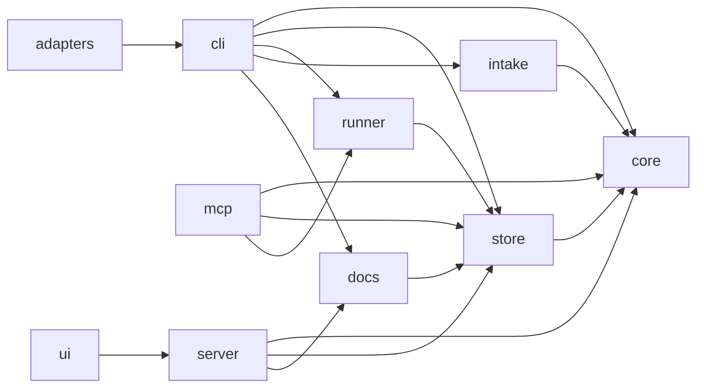

# 9. Arquitetura e roteiro

## Pacotes

Monorepo com workspaces do npm. Cada pacote tem uma responsabilidade só, e nenhum depende da interface de outro além do `core` e do `store`.

```
packages/
  core/          modelo (schemas), leitura e escrita de .lastro/, IDs, máquina de estados, gate, ledger
  store/         acesso ao banco com dois drivers (SQLite e Postgres), migrações, sincronização com os arquivos
  runner/        execução de comandos, condições, leitura de JUnit e SARIF, evidência
  intake/        extratores por tipo de fonte (docx, pdf, chat, audio, video, image), âncoras, versões
  docs/          documentação gerada, relatórios item a item e diagramas (md, html, pdf, mermaid, svg)
  server/        API HTTP e eventos ao vivo para o painel, login e tokens no modo servidor
  ui/            painel (Vite + React + Tailwind + shadcn/ui)
  cli/           o comando `lastro`
  mcp/           servidor MCP (stdio)
adapters/
  claude-code/   hooks, plugin, seção do CLAUDE.md
  github/        action, check, bloco do PR
  claude-ship/   REVIEW.md, esboços de approvals e classificador
  git/           hook pre-push
  codex/, gemini/, cursor/
schemas/         JSON Schema público de cada arquivo de .lastro/
```



O painel nunca lê o banco direto: fala com o `server`, que é o mesmo em `lastro ui` (local) e em `lastro server` (Postgres).

## Stack

| Peça | Escolha | Motivo |
|---|---|---|
| Linguagem | TypeScript estrito, Node 22+ | Mesmo ecossistema do MCP e dos agentes; distribuição por npm |
| Schemas | zod, exportando JSON Schema | Validação em runtime e autocompletar no editor |
| Banco | SQLite (better-sqlite3) no modo local; Postgres 16+ no modo servidor | Zero configuração na máquina; banco compartilhado para o time |
| Acesso ao banco | Kysely, com migrações versionadas | Uma camada tipada que fala com os dois bancos, com o mesmo esquema |
| API do painel | Hono, com eventos ao vivo por SSE | Leve, roda no Node, mesma API nos dois modos |
| Painel | Vite + React + Tailwind + shadcn/ui | Sem SSR, rápido de servir pela própria CLI |
| Diagramas | Mermaid, renderizado no painel e exportado em SVG | Texto versionável, gerado a partir dos dados |
| Gráficos | Recharts | Linhas do tempo e indicadores |
| PDF | Playwright imprimindo o HTML da documentação | Mesmo visual do painel, com logo e cores |
| CLI | commander | Simples e estável |
| MCP | SDK oficial de MCP para TypeScript | Compatível com Claude Code, Codex, Gemini CLI e Cursor |
| DOCX | mammoth (com as imagens na ordem) | Mantém parágrafo e imagem juntos |
| PDF de entrada | pdfjs-dist | Texto por página e bloco |
| Áudio e vídeo | comandos externos configuráveis (Whisper, ffmpeg) | O Lastro não embute modelo |
| Testes do próprio Lastro | Vitest com JUnit, ESLint com SARIF, Playwright no painel | O Lastro verifica a si mesmo |

## Decisões de arquitetura

1. **A spec vive no git; o histórico vive no banco.**
   - A spec é revisada no mesmo PR que o código.
   - Execuções, resultados e métricas crescem sem parar e precisam de consulta rápida no painel.
   - O banco é SQLite na máquina ou Postgres no servidor, com o mesmo esquema.
2. **Sem LLM dentro.** Custo zero, sem chave de API e sem mandar dado de cliente para outro lugar. A inteligência vem do agente do desenvolvedor.
3. **IDs aleatórios curtos.** Sem colisão entre branches. A numeração do cliente fica na âncora.
4. **Evidência só de execução própria.** O gate nunca aceita resultado relatado pelo agente.
5. **Comandos humanos fora do MCP.** O que exige pessoa não tem ferramenta para o agente.
6. **Um painel, dois modos.** O mesmo `server` e a mesma interface atendem o modo local e o modo com Postgres.
7. **Integrações como adaptadores.** O núcleo não conhece Claude, GitHub nem Playwright.

## Segurança e privacidade

- **Modo local:**
  - nenhuma chamada de rede no núcleo;
  - o painel escuta só em `127.0.0.1`.
- **Modo servidor:**
  - o painel exige login;
  - o CI usa token com escopo de projeto;
  - a URL do banco e o token ficam em variáveis de ambiente, nunca no `lastro.yml`.
- **Fontes e segredos:**
  - os binários das fontes ficam fora do git por padrão, e o que vai para o git é configurável;
  - o Lastro nunca lê nem grava segredo do projeto. Os comandos recebem o ambiente do projeto como ele já é.
- **Dependências:** auditadas no CI do próprio Lastro, sem alerta aberto.

## Idiomas

- Documentação em inglês e português do Brasil.
- Mensagens da CLI, do painel e dos relatórios em `en` e `pt-BR` desde o começo, escolhidos por `language` no `lastro.yml`.
- Chaves dos arquivos sempre em inglês. O conteúdo fica no idioma de quem pede.

## Ordem do MVP

A ordem segue o valor:

- primeiro, o que acaba com o "o que está pendente?" e já dá para **ver no painel**;
- depois, o que impede o agente de fingir que terminou;
- por último, o que melhora a entrada de material.

1. **Formato, núcleo e armazenamento.**
   - Schemas, `lastro init`, leitura e escrita de `.lastro/` e IDs.
   - Máquina de estados com as condições de passagem e conferência de citação literal.
   - Perguntas, decisões e `lastro pending`.
   - Camada de banco com SQLite e Postgres, migrações e `lastro sync`.
2. **Painel, primeira versão.**
   - `lastro ui` com visão geral, pacotes, requisito, fontes, perguntas e decisões.
   - Diagramas de rastreabilidade e de ciclo de vida.
   - `lastro docs build` com requisitos, decisões, glossário e relatório do cliente.
3. **Verificação.**
   - Executor de comandos, condições, leitura de JUnit e SARIF.
   - Fluxos por tipo, `lastro verify`, `lastro gate`, ledger e evidência vencida por mudança de arquivo.
   - No painel: catálogo de testes, execuções, diagrama do fluxo de QA com o resultado, indicadores de qualidade, plano de testes e relatório de qualidade na documentação.
4. **Claude Code.**
   - Servidor MCP.
   - Hooks: início de sessão com reinjeção depois de compactação, travas de edição e de comando humano, gate no fim de resposta.
   - Seção do `CLAUDE.md` e plugin.
5. **Modo servidor.**
   - `lastro server` com Postgres, login, tokens para o CI e a página de projetos.
   - Artefatos no S3.
   - Eventos do painel aplicados pelo `lastro sync`.
6. **Entrada de material.**
   - DOCX com imagens na ordem, PDF, conversa exportada.
   - Áudio e vídeo por comandos externos.
   - Versões e diferença entre versões.
7. **Bloqueio externo e Claude Ship.**
   - Hook `pre-push`, action do GitHub e bloco no PR.
   - `REVIEW.md`, esboços de approvals e classificador.
8. **Ecossistema.**
   - Adaptadores para Codex, Gemini CLI e Cursor.
   - Mapa de módulos e linhas do tempo no painel.
   - Exportação JSON para ferramentas de conhecimento de projeto.

**Piloto:** a próxima rodada de entrega de um projeto real, medida com as métricas de [Visão e escopo](02-vision-scope.md#como-se-mede-o-sucesso). O próprio Lastro usa o Lastro a partir da etapa 3.

## Perguntas em aberto

| # | Pergunta |
|---|---|
| 1 | Relação com a Loqivo: integração por exportação, ou a Loqivo vira o portal hospedado do cliente para aprovação e aceite? |
| 2 | Aceite do cliente no MVP: só por referência registrada pelo dev, ou também por um link do painel exposto temporariamente? |
| 3 | O `ledger/` vai no git por padrão, ou só no artefato do CI? |
| 4 | Quantos bloqueios seguidos o hook de fim de resposta permite antes de liberar? |
| 5 | A etapa `design_contract` fica só em regras simples sobre o diff, ou aceita um classificador opcional via agente? |
| 6 | Login do modo servidor: só e-mail e senha no MVP, ou já entrar com GitHub? |
